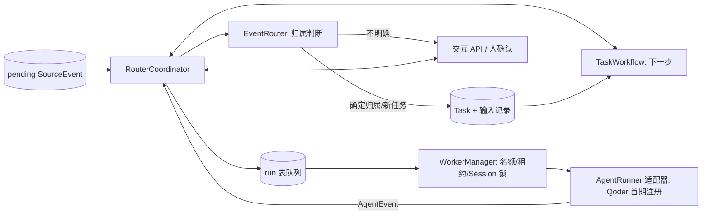
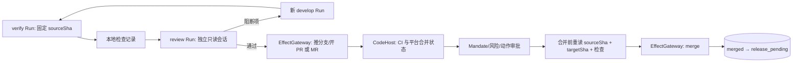

# Agent 自动化中台实施计划（讨论稿）

> 2026-11-03。依据[需求完善版](需求/需求完善版（讨论稿）.md)与[架构设计](架构设计（讨论稿）.md)。从阶段 1 开始，已展开阶段 1 至 6；每个阶段独立验收，按所选来源、仓库和流水线实例逐步落地。每个仓库按配置选择 GitHub 或 GitLab；首个 CLI Agent 按 Qoder CLI 设计。

## 阶段 1：平台架构底座、统一契约与数据结构

### 1.1 目标、范围与完成形态

本阶段建立一个能编译、能迁移数据库、能用本地样本验证契约的 TypeScript 工程。交付的重点是**稳定的业务词汇与模块边界**，使后续接入 GitHub/GitLab 仓库、IM 来源、Qoder、Codex、CI 和发布流水线时只增加适配实现，不改写 Task/Run/审批的含义。

本阶段做：项目结构；各模块的统一数据结构与运行时校验；Task 状态转换基础规则；事件、任务、订阅、运行和记录的 SQLite 初始表及迁移；来源、Router、Task、CLI、人与平台交互、授权、Skill、仓库/CI、持久化的能力接口；单实例的组合入口；最小本地契约测试。后续阶段实现这些接口的真实业务流程与外部适配器；阶段 2 先接页面来源并完成到 Router 的持久交接。

本阶段不做：GitHub/GitLab Issue 扫描、Webhook/IM 接收、图片识别、语义相似检索、Qoder 子进程、真实 Worker 调度、看板、PR/MR、CI 和发布调用。测试中的事件由**样本直接传给统一接入方法**，不能伪称已完成事件发现。安全边界先定义为“无外部副作用能力”；后续每个实际动作再接入执行前门禁。

阶段 1 的运行结果应是：`typecheck`、数据库迁移和各模块数据/接口契约测试通过；一个中文 Bug 样本可按统一结构校验并持久保存，重复样本命中同一事件键；模拟的 CLI 事件与人机问答能通过结构化校验；所有未接入的外部端口在组合入口中明确不可用，而非返回伪造成功。此处只验证底座，不把样本投递给真实 Agent。

### 1.2 技术与代码层级

采用单个 TypeScript/Node.js 服务工程；首期 SQLite + `node:sqlite`，参数化 SQL、短事务、WAL 和本机持久磁盘。先不拆微服务、独立 Message Bus 或多包仓库，也不为六张表引入 ORM。Web 前端在阶段 4 建立，阶段 1 只固定 API 输入/输出契约。[原型的 SQLite Store](/Users/suijiaxuan/Program/Project/Python/Personal/dsh-superagent-prototype-main/src/app/store.ts)可作事务/迁移参考；不复制其 DSH 专属 Session 和 Ticket 模型。

从 `agent-platform` 项目根目录按系统边界组织代码。下列文件标明最终归属；**阶段 1 只创建当前有实际内容的文件**，后续模块随对应阶段落地：

```text
agent-platform/
  skills/                        # 人工维护、提交评审的阶段 Skill 内容
    investigate/SKILL.md         # 调查：阶段 3 使用
    develop/SKILL.md             # 开发：阶段 3 使用
    verify/SKILL.md              # 验证：阶段 5 使用
    review/SKILL.md              # 审查：阶段 5 使用
    release/SKILL.md             # 发布：阶段 6 使用
  src/
    shared/                      # 跨模块共用的 ID、时间、操作者/证据引用和错误类型
    event/                       # 事件层：统一事件、来源接口、规范化、去重入库
      model.ts
      source.ts
      ingress.ts
      sources/                   # 阶段 2：选定页面；后续扩展 IM、GitHub/GitLab Issue
    agent/                       # Agent 中台
      kernel/                    # 阶段 3：事件循环、任务循环及统一协调入口
      task/                      # Task、Subscription、TaskRecord、状态与任务用例
      router/                    # 归属判断契约与候选证据，不接来源或 CLI 实现
      worker/                    # Run、资源调度、AgentRunner 端口、会话与工作区
        agents/                  # 阶段 3：qoder；阶段 6：codex 适配器
    authorization/              # Mandate、风险判断、审批与外部动作门禁
    interaction/                # 人机交互：结构化问题、回答、审批请求与决定
    repository-ci/              # 仓库/CI 层：CodeHost、检查、PR/MR、合并、发布契约
      providers/                # 阶段 5：github、gitlab 实现
    skills/                     # Skill 加载器：按阶段读取、校验、记录路径和 commit
    storage/
      sqlite/                   # SQLite 独立基础设施：连接、事务、迁移、各仓储实现
        migrations/
    api/                        # 阶段 3：交互 API；阶段 4：看板查询与写入契约
    bootstrap/                  # 配置校验、依赖组装、未接入能力显式不可用
  web/                          # 阶段 4：React 看板与前端开发 Skill
  tests/                        # 按上述模块镜像组织契约与行为测试
  需求/
  架构设计（讨论稿）.md
  实施计划（讨论稿）.md
```

`event` 只负责来源到 `SourceEvent`，不直接建 Task；`agent/kernel` 在阶段 3 实现事件循环与任务循环，调用 `agent/router` 的归属能力、`agent/task` 的生命周期规则，并向 `agent/worker` 提交持久 Run 意图；`agent/worker` 通过统一端口执行 Run。`repository-ci` 只封装代码托管与交付平台，事件来源中的 GitHub/GitLab Issues 仍归 `event/sources`；`storage/sqlite` 实现各模块声明的仓储接口，不存放路由或风险规则。`authorization` 是外部副作用的共同门禁，`bootstrap` 注册并注入实际适配器。内核只依赖领域结构和端口，不导入 `storage/sqlite`、来源解析器、具体 CLI、GitHub/GitLab SDK 或流水线实现。

**轻内核边界**：事件循环消费已验证、已持久化的 `SourceEvent`，处理订阅直达、强标识归属、候选/待人、交还与幂等入队；任务循环消费 `AgentEvent`、`HumanResponse`、外部动作回执和恢复信号，维护 Task/Run 状态、挂起/唤醒、授权检查、下一阶段派活与可追溯记录。内核执行侧的通用 WorkerManager 负责配额、租约、Task/工作区/Session 互斥及不确定执行的恢复；启动或续用 Run 前经 `SkillLoader` 选定并加载版本化 Skill，构造统一 `RunRequest` 交给已选 AgentRunner。内核和 WorkerManager 不分析 Bug、不检索/改代码、不解析原始页面或 CLI 文本、不发 GitHub/GitLab 请求，也不执行 CI、合并或部署；这些事实由对应适配器或受控外部动作端口返回，内核只据统一结果推进生命周期。

这里的**插件**是按能力接口在 `bootstrap` 显式注册的进程内适配器，不是运行时任意加载的插件市场。来源按 `sourceId` 注册为拉取/推送适配器，原始数据先在 `event` 侧规范化；CLI 按 `agentKind` 注册 `AgentRunner`，各自处理命令、原生 Session 和输出转换；代码托管按 `repoKey` 注册已绑定仓库的 `CodeHost`，发布流水线按 `(repoKey, environment)` 注册 `ReleasePipeline`。内核只见 `SourceEvent`、`RunRequest/AgentEvent`、统一代码/流水线结果与能力状态；未知键或能力不足明确返回 `unavailable/needs_human`，不得按 provider 或默认实例回退到别的仓库。新增实现只注册对应适配器并通过契约测试，不修改两个循环的分支。

阶段 1 先用小接口描述**必须遵守的能力契约**，用判别联合类型表达拉取/推送或能力支持状态；**暂不预设** `BaseSource`、`BaseAgent` 的继承层级。拉取型与推送型来源不应为了继承同一基类而实现无意义的空方法。

抽象类并非禁止使用。当两个以上实际适配器出现稳定、相同的执行步骤和受保护状态时，再抽取共享实现。例如 GitHub 与 GitLab 的分页重试如果流程确实一致，可复用一个扫描协调器，必要时再用抽象类固定模板步骤；Qoder 与 Codex 的进程启动/回收若有相同逻辑，也可抽共享组件。来源身份、API、Session 恢复和权限规则仍由各适配器负责。选择抽象类的依据是**已有的代码重复和共同不变量**，不是预想以后会有更多平台；否则修改基类容易同时影响所有子类。

首期关键对象的归属固定为：`NormalizedEvent/SourceEvent/EventIngress` 在 `src/event`；两个循环的输入信号与协调入口在 `src/agent/kernel`；`Task/Subscription/TaskRecord/TaskState` 在 `src/agent/task`；`RouteDecision` 在 `src/agent/router`；`Run/AgentRunner` 在 `src/agent/worker`；`Question/Answer/ApprovalRequest/ApprovalDecision` 在 `src/interaction`；`TaskMandate/EffectGateway` 在 `src/authorization`；`CodeHost/CI` 在 `src/repository-ci`。各模块的仓储接口放本模块，实现集中在 `src/storage/sqlite`，避免把领域接口与 SQL 混在一起。

### 1.3 统一数据结构：先固定语义再定列

名称在代码中用驼峰，数据库列用蛇形；字段含义保持一一对应。ID 都作为不透明字符串，只有对应适配器知道 GitHub/GitLab 的平台侧项目与 Issue ID。`metaData` 对应数据库 `meta_data`，只保存经筛选的来源原字段；图片等附件统一放 `attachments: AttachmentRef[]`，持久化为 `attachments_json`。附件引用须经 schema 校验，不传递任意原始 URL；禁止把密钥、图片二进制或平台审批决定放进去。

事件统一结构叫 `NormalizedEvent`：来源适配器从各自原始对象构建它，统一入口再次校验并持久化成带平台 ID/状态的 `SourceEvent`。Router、Task 和 Worker **只接触 `SourceEvent` 的标准字段与必要引用**；如需看来源特有字段，再按引用读取 `metaData`。原始 GitHub/GitLab/IM payload 类型不能进入下游的用例签名。

```ts
type AttachmentRef = {
  id: string; kind: 'image' | 'file'; sourceRef: string;
  mimeType?: string; expiresAt?: string;
}; // sourceRef 是经来源适配器校验的无凭据定位符

type NormalizedEvent = {
  sourceId: string; externalId: string; revision: string;
  kind: string; title: string; body: string;
  threadKey?: string; objectKey?: string; repoKey?: string;
  url?: string; occurredAt?: string;
  attachments: AttachmentRef[]; metaData: Record<string, unknown>;
};

type Action = 'investigate' | 'edit' | 'open_pr' | 'merge' | 'release' | 'rollback';
type TaskMandate = {
  sourceEventId: string; repoKey: string; goal: string;
  allowedActions: Action[];
  maxAutoRisk: 'low' | 'medium' | 'high'; policyVersion: string;
};

type TaskState =
  | 'new' | 'triaged' | 'queued' | 'investigating' | 'developing'
  | 'verifying' | 'reviewing' | 'ready_to_merge' | 'merging' | 'merged'
  | 'release_pending' | 'releasing' | 'released' | 'closed'
  | 'waiting_human' | 'paused' | 'blocked' | 'failed' | 'cancelled';
type RunStage = 'investigate' | 'develop' | 'verify' | 'review' | 'release_prepare'; // Worker 执行阶段
// release_prepare 只整理发布证据；合并、部署和回滚由 EffectGateway 管控，写 TaskRecord.effect/release。
type RunStatus = 'queued' | 'running' | 'waiting_human' | 'paused' | 'succeeded' | 'failed' | 'cancelled';

type RepositoryConfig = {
  repoKey: string; provider: 'github' | 'gitlab';
  hostUrl: string; projectRef: string; targetBranch: string;
  requiredChecks: string[]; credentialsRef: string;
};
type ChangeSnapshot = {
  change: ChangeRef; state: 'open' | 'merged' | 'closed' | 'unknown';
  sourceSha: string; targetSha: string; checks: CheckResult[];
  gate: 'ready' | 'blocked' | 'unknown'; observedAt: string;
};
```

`NormalizedEvent` 不等于来源原始 payload；同一 `(sourceId, externalId, revision)` 表示同一外部变更。`threadKey` 是话题，`objectKey` 是 Bug/Issue 等业务对象，二者均在 `sourceId` 命名空间内。不同评论可归属同一对象但仍是不同事件。`repoKey` 指向 `RepositoryConfig`，不从 `sourceId` 推断 `provider`：IM 等任一来源可以关联 GitHub 或 GitLab 仓库。`TaskMandate` 只能由可信接单规则或人确认形成；Bug 原文、截图和 Agent 自述不能修改它。`goal` 是人可读目标；授权判定使用结构化的仓库、动作、风险和策略版本。

各模块在阶段 1 要落地的**数据结构 + 能力接口**如下。“定义”指真实 TS 类型、运行时 schema 与可编译的接口，不是文档中的名字；只有注明“实现”的本地逻辑会在本阶段运行。

| 模块 | 统一数据结构及关键字段 | 抽象/阶段 1 交付 |
| --- | --- | --- |
| `shared` | `EntityId`、`Timestamp`、`ActorRef(kind,id,source?)`、`EvidenceRef(uri,kind,source?)`、`PlatformFailure(kind,code,message)` | 只保留跨两个以上模块共用的值类型；错误类别至少有 `invalid/conflict/not_found/forbidden/unavailable/retryable`，不建万能工具基类。 |
| `event` | `NormalizedEvent`、持久化的 `SourceEvent(id,status,receivedAt,...)`、`EventRoutingStatus(pending/routing/needs_human/done)`、`AttachmentRef`、`SourceCursor`、`IngestResult(eventId,duplicate)` | `SourceNormalizer<Raw>`、`PollingSource`、`PushSource`、`EventIngress`、`EventRepository`。实现 `EventIngress` 的校验、幂等保存和读取；原始来源类型不得穿透到 Router。 |
| `agent/task` | `Task`、`TaskState`、`TaskTransition(from,to,reason,actor,at,evidenceRefs?)`、`Subscription`、`TaskRecord` 判别联合类型 | `TaskRepository`、纯函数 `transitionTask(task,command)`。实现状态合法性检查与基础转换；Task 可多事件、多轮 Run，订阅只表示归属/上下文，不证明 Bug 因果。 |
| `agent/router` 与 `agent/kernel` | `RouteDecision`：`existing_task/new_task/needs_human/ignored`；`RouteCandidate(taskId,evidence,confidence?)`；`AssociationEvidence(kind,sourceRef,details)`；`KernelSignal` 判别事件 ID、AgentEvent、人决定、外部回执与恢复信号 | `EventRouter.route(eventId)`、`TaskCandidateFinder` 及 KernelCoordinator 端口。强标识可确定归属，文字相似只产生候选；阶段 1 只定信号契约，不运行真实路由与循环。 |
| `agent/worker` | `Run`、`RunStage/RunStatus`、`RunRequest`、`SessionRef(agentKind,sessionId)`、`WorkspaceRef(repoKey,path,baseSha)`、`AgentInput`、`AgentEvent`、`AgentSnapshot`、`AgentUsage(actual/unknown)` | `AgentRunner`、`RunRepository`、`RunScheduler`、`WorkspaceManager` 契约。CLI 原始 stdout/stderr 只在适配器内解析为 `AgentEvent`；阶段 1 不启动进程。 |
| `interaction` | `QuestionRequest(id,taskId,runId,prompt,options?,evidenceRefs,status)`、`Answer(questionId,actor,content,idempotencyKey)`、`RouteReviewRequest(eventId,candidates,reason)`、`RouteReviewDecision(eventId,choice,actor,at,idempotencyKey)`、`ApprovalRequest`（`scope_change` 或 `action` 判别联合）、`ApprovalDecision(requestId,actor,decision,at)`；统一的 `HumanRequest/HumanResponse` 判别联合类型 | `InteractionService.ask/answer/requestApproval/decide` 契约；路由复核由阶段 3 的路由用例经受限入口提交，复用交互消息 schema，不把归属选择当授权审批。范围变更请求包含拟议 Mandate；动作审批绑定 source SHA、目标/环境和策略版本。 |
| `authorization` | `TaskMandate`、`RiskLevel`、`Action`、`PolicyDecision(allow/deny/needs_approval)`、`EffectRequest`、`EffectDecision` | `MandatePolicy.evaluate()`、`EffectGateway.execute()` 契约和默认拒绝规则。后续批准绑定具体动作、代码 SHA、目标和策略版本；未经授权不能调用外部动作。 |
| `repository-ci` | `RepositoryConfig`、`ChangeRef(provider,repoKey,id,sourceSha,targetSha)`、`CheckResult(repoKey,commitSha,status,conclusion,logRef?)`、`ChangeSnapshot(state,sourceSha,targetSha,checks,gate,observedAt)`、`MergeRequest/Result`、`ReleaseRequest/Result/Snapshot` | `CodeHost`、`ReleasePipeline` 契约；GitHub PR/GitLab MR 由适配器统一成 `ChangeRef`，发布流水线独立按仓库和环境配置。阶段 1 不调用外部平台。 |
| `skills` | `SkillRef(repoRef,path,commitSha,stage)`、`LoadedSkill(content,ref)` | `SkillLoader.load(ref)` 契约与路径/阶段配置校验；Skill 文本位于仓库根 `skills/`，由人维护，不在加载器中生成。 |
| `storage/sqlite` | 六表记录映射、`SchemaVersion`、事务结果 | 实现迁移、短事务、事件仓储最小读写；Task/Run/Record 仓储接口可用本地样本验证序列化，暂不实现尚未启用的业务流程。 |

上述数据对象在 TS 中优先用 `type`/`interface` 加运行时 schema；状态规则用 `transitionTask()` 等纯函数，有实际连接状态的 SQLite 组件才用类。这样“统一数据类”有实际校验，但不会为每条记录制造只有 getter/setter 的类。

CLI 和看板交换的是**判别联合消息**，不能让下游解析 Agent 自由文本来判断完成、提问或审批：

```ts
type RouteDecision =
  | { kind: 'existing_task'; taskId: string; contextTaskIds: string[]; evidence: AssociationEvidence[] }
  | { kind: 'new_task'; repoKey: string; mandate: TaskMandate; parentTaskId?: string }
  | { kind: 'needs_human'; candidates: RouteCandidate[]; reason: string }
  | { kind: 'ignored'; reason: string };
type ApprovalRequest =
  | { kind: 'scope_change'; id: string; taskId: string; proposedMandate: TaskMandate; policyVersion: string }
  | { kind: 'action'; id: string; taskId: string; action: Action; sourceSha: string;
      targetSha?: string; changeRef?: ChangeRef; environment?: string; releaseVersion?: string;
      releaseTargetDigest?: string; policyVersion: string };
type AgentInput =
  | { kind: 'task'; runId: string; prompt: string; sourceEventIds: string[] }
  | { kind: 'source_followup'; eventId: string; content: string }
  | { kind: 'human_answer'; questionId: string; content: string; idempotencyKey: string };
type AgentEvent =
  | { kind: 'progress'; runId: string; text: string; at: string }
  | { kind: 'question'; runId: string; question: QuestionRequest }
  | { kind: 'input_handled'; runId: string; eventId: string }
  | { kind: 'handback'; runId: string; eventId: string; reason: string }
  | { kind: 'result'; runId: string; status: 'succeeded' | 'failed'; exitCode: number | null; signal?: string; resultRef?: string }
  | { kind: 'usage'; runId: string; usage: AgentUsage };
type RouteReviewRequest = { eventId: string; candidates: RouteCandidate[]; reason: string };
type RouteReviewDecision = {
  eventId: string; reason: string; actor: ActorRef; at: string; idempotencyKey: string;
} & (
  | { choice: 'existing_task'; taskId: string }
  | { choice: 'new_task'; repoKey: string; parentTaskId?: string; taskId?: never }
  | { choice: 'ignored'; taskId?: never; repoKey?: never }
);
type HumanRequest =
  | { kind: 'question'; value: QuestionRequest }
  | { kind: 'approval'; value: ApprovalRequest }
  | { kind: 'route_review'; value: RouteReviewRequest };
type HumanResponse =
  | { kind: 'answer'; value: Answer }
  | { kind: 'approval_decision'; value: ApprovalDecision }
  | { kind: 'route_decision'; value: RouteReviewDecision };
type KernelSignal =
  | { kind: 'source_event'; eventId: string }
  | { kind: 'agent_event'; taskId: string; event: AgentEvent }
  | { kind: 'human_response'; taskId: string; response: HumanResponse }
  | { kind: 'effect_receipt'; taskId: string; recordId: string }
  | { kind: 'recovery'; taskId: string; runId?: string; effectRecordId?: string };
```

这些是平台内部的统一结构，不代表 Qoder/Codex 已能直接输出相同 JSON。阶段 3 的 CLI 适配器负责从真实进程输出和退出码构造并校验 `AgentEvent`；无法识别的输出只能保存为原始日志/进度，不得伪造成功、问题或批准。`ApprovalRequest` 的 `scope_change` 变体申请扩大 Mandate，`action` 变体申请某个具体副作用；后者对合并必须有 ChangeRef、source/target SHA；对发布或回滚必须有环境、版本和 `releaseTargetDigest`，该摘要绑定仓库、操作、合并 SHA、制品、流水线配置与参数。批准后由 `authorization` 更新结构化授权或放行所绑定的动作，CLI 文本不能直接改写这些决定。

`TaskRecord` 用封闭的 `kind` 判别联合类型：`event_link`、`question`、`answer`、`check`、`review`、`approval`、`effect`、`release`、`state_change`。每种记录在阶段 1 都定义运行时 schema；例如 `event_link` 要有 handle/context 模式与记录完成/待投递/已接收/已处理/不确定/交还状态，`review` 必须绑定 subject SHA、结论与发现项，`approval` 必须有动作、批准人、策略版本和 subject SHA，`effect` 必须有幂等键及回执状态。本阶段对各变体做构造/序列化测试；事件关联从阶段 3、交互与外部动作从对应后续阶段进入真实业务写入路径。

状态转换由 `src/agent/task` 的纯函数统一约束；不能由任意 SQL 或 Agent 文本直接改成 `released`。本阶段固定 `TaskState`：`new/triaged/queued/investigating/developing/verifying/reviewing/ready_to_merge/merging/merged/release_pending/releasing/released/closed/waiting_human/paused/blocked/failed/cancelled`；`RunStatus` 的暂停与等待人答复也分开。`released` 表示发布事实，`closed` 表示该轮任务完成，两者不能混用。阶段 1 实现基础合法性转换与非法越级拒绝，后续阶段补齐各业务动作的转换条件；状态历史进入 `TaskRecord`，重开时增加 `iteration` 而不覆盖上一轮发布记录。

### 1.4 统一方法与端口契约

应用层以用例函数表达可执行意图，端口只表达必须的外部能力。阶段 1 **实现事件保存与读取的最小路径**；其余方法定义输入/输出和错误类型，实际流程在相应阶段实现。接口草案如下，最终命名在编码时可微调，但语义和边界不变：

```ts
interface EventIngress {
  accept(event: NormalizedEvent): Promise<{ eventId: string; duplicate: boolean }>;
}
// 每个来源适配器内部实现；Raw 不暴露给应用层。
interface SourceNormalizer<Raw> {
  normalize(raw: Raw, source: TrustedSourceContext): NormalizedEvent[];
}
interface PollingSource {
  read(cursor?: string): Promise<{ events: NormalizedEvent[]; nextCursor?: string }>;
}
interface PushSource {
  verifyAndNormalize(raw: Uint8Array, headers: Record<string, string>): Promise<NormalizedEvent[]>;
}
interface AttachmentReader {
  open(sourceId: string, ref: AttachmentRef): Promise<ReadableStream<Uint8Array>>;
}
interface AgentRunner {
  capabilities(): AgentCapabilities;
  start(request: RunRequest): Promise<AgentHandle>;
  resume(request: ResumeRequest): Promise<AgentHandle | Unsupported>;
  send(handle: AgentHandle, input: AgentInput): Promise<Accepted | Unsupported>;
  read(handle: AgentHandle): Promise<AgentSnapshot>;
  cancel(handle: AgentHandle): Promise<Accepted | Unsupported>;
}
interface CodeHost {
  readChecks(commitSha: string): Promise<CheckResult[]>;
  openChange(request: ChangeRequest): Promise<ChangeRef>;
  readChange(change: ChangeRef): Promise<ChangeSnapshot>;
  merge(request: MergeRequest): Promise<MergeResult>;
}
interface EffectGateway {
  execute(request: EffectRequest): Promise<EffectDecision>;
}
interface EventRouter {
  route(eventId: string): Promise<RouteDecision>;
}
interface KernelCoordinator {
  onSignal(signal: KernelSignal): Promise<void>; // 阶段 3 实现；先落持久事实再唤醒循环
}
interface InteractionService {
  ask(request: QuestionRequest): Promise<QuestionRequest>;
  answer(value: Answer): Promise<void>;
  requestApproval(request: ApprovalRequest): Promise<ApprovalRequest>;
  decide(value: ApprovalDecision): Promise<void>;
}
interface SkillLoader {
  load(ref: SkillRef): Promise<LoadedSkill>;
}
interface ReleasePipeline {
  start(request: ReleaseRequest): Promise<ReleaseResult>;
  findByRequestKey(requestKey: string): Promise<ReleaseSnapshot | null>;
  read(runRef: string): Promise<ReleaseSnapshot>;
}
```

其中 `AgentCapabilities` 的每项取 `supported/unsupported/unverified`，不可把“CLI 帮助中有参数”视为已验证。`RunRequest` 至少包括 Task/Run ID、阶段、当前 Mandate、仓库及工作区、基线/目标 commit、输入摘要与来源引用、已加载的 LoadedSkill（正文与 SkillRef）、时长/用量上限。run 表只保存 SkillRef，不复制 Skill 正文。`AgentHandle` 关联 Run、原生 Session 和子进程；`AgentSnapshot` 区分运行中、完成、失败及结果引用。`Unsupported` 是显式结果；不能伪造续聊、投递或取消成功。后续验证 Qoder 实际能力后才实现 `AgentRunner`。`ReleasePipeline` 的按键查找和状态读取用于阶段 6 的超时恢复；不能核查外部事实的流水线转人工处理，不盲重发发布请求。

`AttachmentReader` 由来源适配器提供，按受信 sourceId 与附件引用重新校验授权、大小和媒体类型后读取；阶段 1 只定契约，阶段 2 随选定页面实现，阶段 3 的 Worker 按需读取并交给有视觉能力的 CLI，过期或无权时转为待补充问题。`SourceNormalizer<Raw>` 只是来源适配器内部的构建约定：首期页面项及后续 GitHub Issue、GitLab Note、IM 消息各自解析原始格式、提取稳定身份与附件引用，并由可信来源配置赋予 `sourceId` 和仓库映射。`EventIngress` 统一执行运行时 schema 校验、去重和保存；缺少稳定 `externalId` 时拒绝，缺少可信 `repoKey` 时可保存事件并由 Router 转待人处理，不从正文猜补。这样新增来源只需增加适配器，Router 不增加针对平台格式的分支。

`CodeHost` 与 `EffectGateway` 的职责不同：前者是代码平台能力，后者是**执行前授权检查、幂等记录和外部调用**的唯一入口；`EffectDecision` 区分拒绝、待审批和已执行。组合入口根据 `RepositoryConfig.provider` 为对应 `repoKey` 绑定 GitHub 或 GitLab `CodeHost`；`CodeHost` 方法作用于已绑定仓库，统一返回变更请求、检查和合并结果，平台特有 ID 留在适配器。实际合并/发布在后续阶段由它们组合，`CodeHost` 的写入能力及 `ReleasePipeline` 只在 Gateway 内组装；Worker 永远不直接持有合并和生产发布凭据。`NormalizedEvent` 可由人工测试样本注入，但生产代码只能由已注册来源适配器调用 `EventIngress`。阶段 1 不开放无鉴权的“提交任意事件”HTTP 接口。

应用层还预留 `routeEvent(eventId): RouteDecision`、`enqueueRun(taskId, stage): RunRef`、`claimRun(workerId): RunLease | undefined`、`recordAnswer(questionId, answer): AnswerRef`、`requestEffect(action): EffectDecision` 等用例签名。**只保留签名和类型，不实现空壳成功返回**；各阶段上线前必须有对应实现、失败语义及契约测试。`RouteDecision` 明确区分 `existing_task`、`new_task`、`needs_human`、`ignored`；相似匹配只生成候选，不能自动合并或重开。

### 1.5 SQLite 初始模型与事务边界

按架构设计的**六张表**建初始迁移：`event_source`、`source_event`、`task`、`subscription`、`run`、`task_record`。本阶段通过迁移和仓储最小读写证明模型可用，先不接事件扫描或 Worker 领取。`subscription` 用 `target_kind + target_key` 在同一张表支持 Thread 与 Bug 对象；不增加第七张关联表。

必须从第一版就有的约束：

- `source_event` 唯一 `(source_id, external_id, revision)`；保存标准 `kind/title/body` 与可选发生时间，初始路由状态为 `pending`，索引 `(source_id, object_key)` 和 `(status, lease_until)`。`meta_data` 为受校验 JSON，仅保留来源原字段；`attachments_json` 保存标准 AttachmentRef 列表；阶段 3 的 `routing_data` 单独保存类型化候选与人工决定，不混入来源数据。
- `task.origin_event_id` 非空时唯一；`task.iteration >= 1`；Mandate 和状态写入前校验。
- `subscription` 唯一 `(task_id, source_id, target_kind, target_key)`；索引 `(source_id, target_kind, target_key)`；`mode` 只允许 `handle/context`。
- `run` 索引 `(status, stage, priority)`，租约和尝试次数用于后续调度；不能对 `session_id` 全表唯一，因为相关新 Task 可能续用同一 Session，实际并发锁在运行态约束。
- `task_record` 的 `event_link` 对 `(task_id,event_id)` 唯一；待外部执行的 `effect` 记录对幂等键唯一；审批、检查带 subject SHA。按 `(task_id,at)` 提供时间线读取。

迁移用有序版本号执行，失败整笔回滚；启动先检查数据库版本，拒绝未知的未来版本。`node:sqlite` 写事务保持短，不在事务内等待 CLI、代码托管 API、图片或 CI。阶段 1 的事件保存是唯一真实业务写入路径：验证输入 → 在事务内插入 → 唯一冲突时返回已有事件 ID。路由、建 Task、入 Run、外部副作用的跨表事务在后续阶段实现，但它们的事务边界先写成契约：**事件完成状态、任务归属和 Run 入队同事务；任何外部副作用先有持久意图记录再执行，恢复时先核对外部事实。**

### 1.6 安全、配置与扩展约束

配置按“仓库、来源、Agent、预算、风险策略引用”划分，阶段 1 只建配置 schema，不填虚构的托管平台凭据或 Qoder 能力。每个仓库必须指定 `provider`、平台地址、项目引用、目标分支及凭据引用；未配置或不支持的 `provider` 在启动时拒绝，不静默退到另一平台。来源配置与仓库配置分开。敏感值只存环境/密钥服务引用，不进入 `meta_data`、数据库日志或测试快照。默认 Mandate 不允许合并、发布和跨仓库动作；测试样本也不能绕过授权构造函数。权限检查不能只靠提示词或 Skill，真实执行账号的权限将在 Agent 接入阶段核验。

平台仓库根目录 `skills/` 放由人维护和评审的阶段 Skill；`src/skills` 只实现按阶段选择、读取与记录版本的加载逻辑，**不存放 Skill 正文**。阶段 1 建立路径/版本配置及 `skills/README.md`，对应阶段开始时再由人编写各 `SKILL.md`，不创建空壳指令。运行记录的 `skill_ref` 保存 Skill 所在仓库、路径和 commit SHA；若目标仓库有专属 Skill，可由配置明确选用其版本化路径。Qoder 原生 Skill 目录是否自动加载由阶段 3 验证，Codex 的同类能力在阶段 6 验证，平台不依赖隐式自动发现，也不生成/改写 Skill。图片只存附件引用与可见信息的后续观察记录，不在 DB 中复制二进制。模型/CLI 用量允许 `unknown`，不使用 0 冒充未知。

为将来扩展保留的稳定点只有四个：来源输入契约、Agent 运行契约、代码托管/外部动作契约、持久领域语义。阶段 1 固定内核与适配器的依赖方向及按 sourceId、agentKind、repoKey、环境选择的注册契约；新增来源、CLI 或代码平台以新增适配器和能力测试完成。**不要**在阶段 1 预建插件市场、动态加载框架、通用工作流 DSL、消息总线、三套阶段队列或自动 Skill 沉淀。

### 1.7 具体实施步骤与检查

| 顺序 | 本阶段要做的事 | 产物 | 验收方式 |
| --- | --- | --- | --- |
| 1 | 初始化单 TS/Node 工程、分层目录、`skills/README.md` 和依赖方向规则；为阶段 3 的 `agent/kernel` 标明两循环入口 | 可运行的 `typecheck/test/build` | `event` 不导入 `agent`，内核与业务模块不导入 `storage/sqlite` 或任何具体适配器 |
| 2 | 实现 `shared` 基础值类型与错误判别联合，并在 `event` 定义 `NormalizedEvent/SourceEvent/AttachmentRef/SourceCursor` 及来源契约 | 事件 schema、Normalizer/Ingress 接口 | 来源无关的本地样本可构造并校验同一结构；缺稳定 ID 或非法附件引用被拒；不实现 GitHub/GitLab/IM 来源适配器 |
| 3 | 在 `agent/task` 定义 Task、状态、订阅、TaskRecord，并实现基础状态转换；在 `agent/router` 定义路由决定与候选证据 | Task/Router 模型与纯状态规则 | 合法状态变化有结构化记录；`new → released` 等越级转换被拒；弱相似不能成为确定归属 |
| 4 | 在 `agent/worker` 定义 Run、CLI 输入/事件/快照、Session 与工作区引用及 Agent 能力接口 | Worker/CLI 统一契约 | 两种模拟 CLI 原始结果能转换为同一 `AgentEvent`；未知输出不变成“成功” |
| 5 | 在 `interaction` 和 `authorization` 定义结构化问答/路由复核/审批、Mandate、风险和外部动作决定 | 人机交互与门禁契约 | 路由选择与批准互不混淆；批准缺动作/SHA/策略版本时无效；默认拒绝外部动作 |
| 6 | 在 `repository-ci`、`skills`、`bootstrap` 定义仓库配置、CodeHost/发布接口、SkillRef/Loader 和按 sourceId、agentKind、repoKey/环境选择的注册契约 | 仓库/CI/Skill/配置契约 | 多个同 provider 仓库仍分别绑定替身；未知键或能力不满足显式拒绝；Skill 缺路径/commit 无法加载 |
| 7 | 在 `src/storage/sqlite` 创建六表第一版迁移、唯一约束和事务封装，对各模型做本地序列化读写 | SQLite 迁移和仓储实现 | 新库可迁移、重复迁移无变化、失败回滚；Task/Run/Record 样本读回结构一致 |
| 8 | 在 `src/event` 实现**唯一的最小业务路径**：标准事件校验、幂等保存、按 ID 读取 | `EventIngress.accept` | 重复事件只一行；同文不同外部 ID 是两行；`meta_data` 可读且不含密钥/二进制 |
| 9 | 在 `bootstrap` 组装本地自检；未接入的来源、CLI、CI/发布端口显式报 `unavailable`，运行统一契约与迁移测试 | 构建结果与交接清单 | `typecheck/test/build` 全通过；无外部凭据能运行自检，不能误触外部动作 |

实施时先以领域类型和数据库约束定含义，再增加用例；不要先写某个平台或 CLI 的类后倒推通用对象。每个用例的调用方、失败返回和事务边界必须能从代码直接看出。文件和接口以可运行的最小切片创建，不为后续阶段放空类或空目录。

### 1.8 阶段 1 验收场景与交接

1. 用本地样本提交“中文 Bug 描述 + 图片引用”：校验通过，`meta_data` 保留来源字段、`attachments_json` 保留标准附件引用，数据库不含图片二进制。
2. 同一 `sourceId/externalId/revision` 重复提交返回原 `eventId` 且标记重复；只改变正文但保持相同键不能覆盖原事实，应按来源版本生成新 revision。
3. 两个来源相同数字的 Bug ID 不会在身份键或订阅契约中相撞；同一来源下不同评论可以有相同 `objectKey/threadKey` 而事件 ID 不同。
4. 不带授权的测试调用不能构造“允许合并/发布”的有效 Mandate；任何未配置的外部执行端口都返回明确不可用。
5. 新库迁移、再次启动、迁移失败回滚和未来版本拒绝均可验证；本地测试无 GitHub/GitLab/Qoder 凭据也能完成。
6. `Task`、`Run`、原生 `Session` 和来源 Bug 的 ID 在类型与记录中分开；状态、审批/检查版本和 Skill 引用有明确字段。
7. 两个同为 GitHub 或 GitLab 的仓库也分别选中绑定自身 `repoKey` 的 `CodeHost` 替身；事件来源与 CLI 按各自身份独立选择；未知平台、仓库键、环境或 Agent 能力明确失败，不发生跨仓库或跨 Session 调用。
8. 文档化未验证的 GitHub/GitLab 事件 ID、图片权限、变更请求与 CI 接口，以及 Qoder Session 恢复/取消/用量和真实隔离权限，交给对应后续阶段验证；本阶段不把它们标为已实现。
9. `TaskState` 拒绝无证据的越级变化；`iteration` 与状态历史结构能表达重开而不覆盖前一轮记录。`RouteDecision` 的弱相似候选不能伪装成确定归属。
10. `AgentInput/AgentEvent/AgentSnapshot` 的各变体通过校验与序列化；未知 CLI 输出不能成为 `succeeded`。`AgentUsage` 未知值保持 `unknown`，不写成 0。
11. `HumanRequest/HumanResponse` 的问答、路由复核与审批互不混淆；路由复核选择已有 Task 时必须带 `taskId`，选择新 Task 时必须带受信配置内的 `repoKey`；二者均不得当成授权批准；回答投递有幂等键；动作审批缺少操作者、动作、策略版本或受审代码 SHA 时被拒；合并审批缺 ChangeRef/目标 SHA 时被拒，范围变更须包含拟议 Mandate。
12. `SkillRef` 能区分阶段、来源仓库、路径和 commit；`CheckResult/ChangeRef` 能区分 GitHub 与 GitLab 项目，`ReleaseRequest` 用 repoKey/环境选择独立的流水线配置，配置选错不能跨仓库或环境调用。

通过标准：本阶段代码能构建，数据库/领域契约测试通过，最小事件保存路径确实运行，内核端口与进程内适配器的依赖方向可检查，未配置外部能力不会产生副作用。**这不是端到端 Agent 产品验收**；真实事件获取和执行从阶段 2/3 开始。

## 阶段 2：页面定时扫描、事件规范化与 Router 交接

### 2.1 目标与边界

本阶段只接入一个已配置的 DevOps 缺陷页面接口来源。定时任务扫描来源，将配置范围内发现的每条独立事件转换为阶段 1 的 NormalizedEvent，经 EventIngress 校验、去重并保存为 SourceEvent，再以持久化的 pending 事件交给 Router。Router 的任务归属、候选判断、Task 创建和 Run 入队在阶段 3 实现；本阶段可用测试替身验证交接，不把测试替身当成真实 Router。

GitHub/GitLab 仍是代码仓库的托管选项。GitHub/GitLab Issue 发现、IM 推送和其他页面来源只保留 PollingSource、PushSource、SourceNormalizer 与 EventIngress 扩展接口，不编写这些来源的真实适配器或演练其外部 API。阶段 2 不启动 Qoder，不创建 Task/Run，不处理审批、代码或发布。

进入条件是阶段 1 的统一事件 schema、EventIngress、EventRepository、六表迁移与来源/仓库配置校验已通过。当前 DevOps 适配器已有列表/详情读取、事件映射和默认扫描频率的离线实现；真实凭据获取与刷新、接口及图片权限仍须验证，不能将离线测试视为真实来源验收。新增页面来源时仍须先确认地址、访问方式、条目边界、稳定 ID、版本字段和附件权限，不在文档中猜测结构。

### 2.2 数据流和模块边界

    定时扫描 → 页面适配器读取/解析 → SourceNormalizer<页面原始项>
      → NormalizedEvent → EventIngress.accept → SourceEvent(status=pending)
      → EventRepository 待处理读取 → Router（阶段 3 实现真实决策）

页面适配器只处理访问页面、提取原始项和来源特有字段映射；EventIngress 统一校验与幂等入库；Router 只按 eventId 获取标准 SourceEvent，不接收 HTML、DOM 或来源原始对象。扫描器与 Router 通过 SQLite 中的 pending 事件交接，进程重启后仍可读取。阶段 2 用测试 Router 验证 eventId 和标准字段可以被消费；真实 EventRouter.route 及路由状态转换在阶段 3 实现。

代码落点：`src/event/sources/*` 放具体来源适配器，`src/event/poll.ts` 负责单轮扫描，`src/event/ingress.ts` 复用阶段 1 的入口；`src/bootstrap/scheduler.ts` 负责定时触发，`src/bootstrap/start-schedules.ts` 负责来源与处理器组装，来源与事件仓储实现在 `src/storage/sqlite`。`bootstrap` 按 sourceId 绑定页面适配器，`src/agent/router` 与后续 `src/agent/kernel` 只保留标准事件契约，本阶段不放页面解析分支。后续 IM 和 GitHub/GitLab Issue 来源各自增加适配器，复用同一入口与交接机制，不改内核输入。

### 2.3 页面配置与统一事件映射

`config/platform.json` 声明唯一 sourceId、来源类型、配置引用和启停；`event_source` 保存这些来源身份与可选 SourceCursor。`config/schedules.json` 保存定时任务 ID、类型、启停、扫描间隔、启动即运行和来源参数；可选 repoKey 必须匹配受信仓库配置，页面正文中的仓库名不能直接决定 repoKey。页面地址/选择规则、认证、分页或滚动方式、限速及图片获取方式作为来源适配器细节；凭据由受信提供器注入，不写入任务 JSON。来源配置与 RepositoryConfig 独立。

每个页面原始项必须映射到 sourceId、externalId、revision、kind、title、body、attachments、metaData；可确定时再提供 objectKey、threadKey、repoKey、url、occurredAt。externalId 必须标识独立事件，优先使用页面提供的稳定条目 ID 或永久链接；不能用正文哈希合并两个相同描述。revision 必须让同一事件的同一版本在重扫时保持不变，内容或状态真正变化时才变化。没有可靠身份或版本规则的页面项应报告具体错误/待配置项，不能生成随机 ID 冒充稳定事件。

中文原文保留；图片只保存经 AttachmentRef schema 校验的引用及访问所需的安全元数据，不写二进制、密钥或任意可访问 URL。无法判断附件权限或失效期限时记录限制，阶段 3 再决定如何向人补充；本阶段不做 OCR、视觉判断或代码定位。来源特有字段经筛选写入 metaData；附件写入标准 attachments 字段，Router/Worker 不解析来源特有字段也能判断事件身份并按权限读取图片。

### 2.4 扫描、去重和可靠交接

定时任务由 `bootstrap` 在启动时加载并校验：任务 ID 唯一、类型存在、参数有效，任务的 sourceId 与受信来源类型和 configRef 一致，启用的任务不能指向禁用来源；同一来源不能配置多个扫描任务。当前 DevOps 扫描在组装层拒绝重复 sourceId，通用调度器只保证同一任务不重叠；后续增加其他轮询适配器时必须保留按 sourceId 串行约束。启用任务可在启动时立即执行，之后按间隔运行；执行失败报告错误，不停止其他任务。停止时清除定时器、等待在途扫描并关闭数据库。配置修改后重启生效，首期不做热更新。`src/bootstrap/main.ts` 是服务入口；授权请求头由受信模块提供，真实凭据获取与刷新方案仍待接入。

定时任务按 sourceId 串行扫描，避免同一来源并发推进游标。每次扫描只处理配置范围内的页面项，按目标页面的分页/加载方式完整遍历；若页面没有增量游标，可有界重扫，依靠 (sourceId, externalId, revision) 唯一键去重。不能因为“当前页没有变化”就跳过尚未访问的页。访问失败、任何页面项无法规范化或任意页未完成时记录错误且不推进 SourceCursor；已成功保存的事件保留，下一次重扫仍能幂等处理。只有整轮覆盖成功后才提交新游标。外部读取和图片获取不占 SQLite 事务。

EventIngress.accept 对每个 NormalizedEvent 返回 eventId/duplicate。新事件持久化为 pending；重复事件返回原 eventId，不覆盖旧事实，也不生成第二次交接。若重复事件的原记录仍是 pending，仍可由 Router 后续处理。扫描器不直接调用 TaskRepository、RunRepository 或具体 Agent。交接测试验证重启后 pending 事件可按 ID 读取，并可由测试 Router 取得相同标准数据；阶段 3 再实现领取租约、RouteDecision 和完成状态的原子提交。

### 2.5 具体实施步骤

| 顺序 | 做什么 | 代码/数据落点 | 验收 |
| --- | --- | --- | --- |
| 1 | 对当前 DevOps 来源核对访问、条目边界、稳定 ID、版本、附件和扫描频率；新增页面来源时另行确认 | 来源配置与去敏页面样本 | 每项能说明独立事件身份；真实接口与权限未验证项明确记录 |
| 2 | 实现配置驱动的定时任务、来源启动校验与 PollingSource.read，处理页面遍历、错误与 SourceCursor | src/bootstrap/scheduler.ts、src/bootstrap/start-schedules.ts、src/event/poll.ts、src/event/sources/*、src/storage/sqlite | 启动前拒绝无效参数、重复来源和禁用来源；同来源无重叠扫描；停止等待在途任务；失败不前移游标 |
| 3 | 将 DevOps 原始条目转换为 NormalizedEvent，校验 AttachmentRef 和受信 repoKey | src/event/sources/devops、tests/stage2.test.ts | 中文、图片、同文不同事件、同事件编辑均保持正确身份 |
| 4 | 复用 EventIngress.accept 和唯一约束持久化 SourceEvent | src/event/ingress.ts、EventRepository | 重扫只返回同一 eventId；原事件内容不被覆盖 |
| 5 | 实现 pending 事件的读取/交接查询，用测试 Router 验证按 eventId 消费标准数据 | EventRepository、src/agent/router 测试替身 | 重启后可消费；Router 不依赖页面原始结构；本阶段无 Task/Run |
| 6 | 运行去敏样本、扫描中断、重复扫描；凭据可用后补真实接口只读演练 | tests/stage2.test.ts、运行记录 | 下节场景通过，来源限制和未验证项有记录 |

不为未来来源建立空的 GitHub/GitLab 或 IM 实现文件，也不增加 Message Bus；新增来源时只实现其适配器、注册配置和来源契约测试，内核无来源特有分支。

### 2.6 验收与阶段交接

1. 同一页面事件重扫、重启后只保留同一版本的一条 SourceEvent；同文不同条目仍是两个事件；编辑产生新 revision。
2. 页面跨页时中途失败不推进游标，恢复后无漏项；无法确定稳定 ID 的条目不会以随机 ID 写入。
3. 中文描述和图片引用以统一结构保存；页面 AttachmentReader 能按授权读取样本图片，非法或过期引用被拒，数据库没有图片二进制。
4. 事件落库后为 pending；扫描器停止或重启后，测试 Router 仍能通过 eventId 读取完整标准 SourceEvent。
5. 阶段 2 不产生 Task、Subscription、Run 或 RouteDecision 的业务结果；GitHub/GitLab Issue 与 IM 事件发现保持未实现，仓库托管配置仍可独立选 GitHub 或 GitLab。
6. 真实凭据和只读访问可用时完成 DevOps 来源演练；此前仅能通过去敏样本验证通用链路，阶段 2 的真实来源验收不能标记通过。
7. 修改任务配置并重启后，间隔、启停、启动即运行和参数生效；重复 sourceId、来源身份不匹配、无效参数在启动前报错；任务失败可观测，停止等待在途扫描。首期不要求运行时热更新。

交给阶段 3 的输入是持久的 pending SourceEvent 和 EventRepository 读取契约。阶段 3 先实现 Router 领取、归属/待人确认、Task 关联与 investigate Run 入队，再接 Worker；Router 业务规则继续遵守架构设计中的授权与证据边界。

## 阶段 3：Router 协调 Task 与 Worker

### 3.1 设计核心

阶段 2 交付 pending SourceEvent；阶段 3 在 `src/agent/kernel` 建立持续运行的轻内核。内核的两个循环拥有“事件归谁、Task 下一步做什么、何时派 Run、何时找人”的协调权；Worker 适配器只执行一个 Run 并回报结构化结果。Task 是业务生命周期，Run 是一次执行，Session 是 CLI 原生上下文，三者不能合并成一个状态。

借鉴 DeepSeek 原型的 Source → Trigger → Eval → Ticket → Assignment → Executor、订阅直通和 Worker 向主入口报告；在本平台分别映射为 SourceEvent → Router 决策 → Task → Run → Qoder Worker。原型的一 Ticket 固定一 Session、单 GitHub 仓库和 DSH 主 Session 不直接照搬：本平台 Router 是持久服务，可选模型仅辅助模糊判断；一个 Task 可以有多个 Run，相关 Task 可在安全检查后共享旧 Session。参考：[官方原型领域模型](https://github.com/deepseek-ai/dsh-superagent-prototype/blob/main/docs/001-domain.md)、[执行与恢复](https://github.com/deepseek-ai/dsh-superagent-prototype/blob/main/docs/003-execution.md)。



| 组件 | 唯一职责 | 不负责 |
| --- | --- | --- |
| KernelCoordinator（RouterCoordinator） | 运行事件循环与任务循环；调用归属/流程决策；在事务中落决定并排 Run；对外汇总状态 | 运行 CLI、解析页面、调用代码平台 API |
| EventRouter + TaskCandidateFinder | 强关联、候选、待人、新 Task 的 RouteDecision | 写数据库、判断修复因果 |
| TaskWorkflow | 根据当前 Task、Mandate、最新 Run/人的决定计算下一步与合法状态转换 | 启动进程、越权扩 Scope |
| WorkerManager + RunScheduler | 从 run 表领取、限制并发、锁 Session/工作区、启动/停止/恢复 AgentRunner | 决定业务目标、批准高风险动作 |
| AgentRunner 适配器（首个为 QoderRunner） | RunRequest → AgentInput/AgentEvent/AgentSnapshot；保留 CLI 原始日志引用 | 直接改 Task 状态、向用户发送最终结论 |

实现落点：`src/agent/kernel/{coordinator,event-loop,task-loop}.ts` 封装两循环；`src/agent/router/{route-event,resolve-route}.ts` 实现来源无关的归属判断；`src/agent/task/{model,transition,repository}.ts` 定义生命周期；`src/agent/worker/{manager,scheduler,workspace,agents/qoder}.ts` 负责通用资源管理与首个 CLI 适配。`bootstrap` 按 `agentKind` 注册 AgentRunner、按 `repoKey` 注册 CodeHost、按来源身份注册 EventSource 能力，内核仅拿端口。业务接口仍用小接口和判别联合，不新建 BaseRouter/BaseWorker 或万能 Plugin 基类。

### 3.2 Router 的两个循环

**事件循环**：EventRepository 领取 pending SourceEvent → 先检查可信来源、repoKey 与 Mandate 规则 → 查 subscription 的 handle/context → 产出 RouteDecision。唯一开放 handle 订阅直达该 Task；context 只附证据，不获得处理权。强标识命中多个处理者、来源不明或只有相似文字时进入 needs_human；无匹配且可信规则允许时创建新 Task。已 released/closed Task 的同对象反馈先建 parentTaskId 指向旧 Task 的关联调查 Task，不继承授权，不直接认定回归。Worker 若发现直达输入超范围，可 handback 给 Router 重新判断；同一 eventId/Task 最多 handback 一次，避免循环。循环只读统一字段与必要引用；页面、IM、GitHub/GitLab Issue 的解析、附件获取和来源鉴权均在事件适配器内。

**订阅直通的落库与投递**（“直通”只绕过重新做归属判断，不绕过持久化和授权）：

1. 仅在同一 sourceId 下用 objectKey、threadKey 查 subscription；唯一开放 handle 命中后校验 repoKey、TaskMandate 和来源范围。多个 handle、已结束 Task 或范围不明转 Router 候选/待人路径；context 订阅只写上下文关联。
2. 同一事务把 SourceEvent 标为 done，写唯一 (taskId,eventId) 的 TaskRecord.event_link：handle 为 pending，context 为 recorded 且只记关联；同一 Task 同时命中 handle/context 时以 handle 为准。事务提交后 RouterCoordinator 唤醒该 Task；重复扫描不会创建第二条输入。
3. WorkerManager 在安全输入边界领取该 Task 的 pending 链接：活跃 Run 若所选 AgentRunner 报告支持送入原 Session，就用 eventId 构造 AgentInput.source_followup；空闲 Task 由 TaskWorkflow 创建唤醒 Run；已有 queued Run 时把后续事件并入该 Run 的待投递输入，不逐事件创建 Run；waiting_human 时保留自动输入，不抢占人的答复。所选适配器不支持运行中送入时，待当前 Run 结束后创建后继 Run 并交接。
4. CLI 确认接收后标记 delivered；只有经校验的 AgentEvent.input_handled 明确指向该 eventId，才标记 handled。发送结果无法确认则标 uncertain 并停止自动重发。Worker 发出经校验的 AgentEvent.handback 时改为 handback，保存理由、把 SourceEvent 从 done 条件更新回 pending 并排除原 Task；同一 eventId/Task 只允许一次交还，避免循环。

此处的队列就是 source_event 与 TaskRecord.event_link 的待处理状态，不另建 message_bus 或 task_input 表。阶段 1 定义 event_link 状态 schema，阶段 3 实现状态转换和必要索引；TaskRecord 唯一键和事件状态条件更新保证领取与恢复可审计。

**任务循环**：TaskWorkflow 接受五类统一信号：新事件、Worker 的 AgentEvent、人的 HumanResponse、受控外部动作回执、租约/进程恢复结果。它只返回下一动作：继续当前 Run、排指定阶段 Run、等待人、暂停/失败或关闭。KernelCoordinator 统一调用它并写事务；Worker 不写 TaskState。已归属 Task 的后续事件进入 TaskRecord.event_link 的待投递状态：运行中投 AgentInput.source_followup，空闲时由流程决策唤醒；同一 eventId 只交一次，不为每条评论重跑全局归属。对已结束 Task 和超范围输入仍回 Router 重新接单。循环不决定某条测试命令、PR/MR API 或流水线参数，只根据适配器返回的经校验事实与门禁结果推进状态。

| 信号 | Router/TaskWorkflow 动作 | Task / Run 结果 |
| --- | --- | --- |
| 新 Bug 且可信接单 | 创建仅调查 Mandate、Task、Subscription、investigate Run | Task=queued；Run=queued |
| Worker 开始/报告进度 | 记录 Run/TaskRecord；供阶段 4 看板读取 | Task=investigating 或 developing；Run=running |
| 调查提问 | 存 QuestionRequest，释放 Worker 名额 | Task/Run=waiting_human |
| 调查结论 | 有 edit 授权且隔离可用才排 develop；否则请求范围决定 | develop Run=queued 或 Task=waiting_human |
| 开发结果 | 保存 diff、commit SHA、本地检查；排 verify Run 交阶段 5 | Task=verifying；verify Run=queued，调度器此时不领取该阶段 |
| 失败/超时/取消 | 核查进程与外部事实；可恢复才重排，其他等人 | failed/paused/cancelled；原因留痕 |
| 人回答/批准/接管 | 校验身份、Mandate、所指 Run/Session 后唤醒或暂停 | 同一答案不重复投递 |

路由结果、事件 done、Task/Subscription/TaskRecord 和首次 Run 在**同一短事务**提交；先存待执行意图，再由 WorkerManager 在事务外启动进程。领取用租约和条件更新；重试依赖 eventId、origin_event_id、event_link、Run.requestKey 和回答幂等键，不能仅靠进程内 Map。六张表不变，阶段 3 可补索引/列。TaskWorkflow 以 taskId、iteration、stage、signalId 生成稳定的 Run.requestKey；signalId 取首个唤醒 eventId、上一个 Run 结果 ID 或人的决定 ID，重试复用该键，人工明确重试使用新 signalId。同一 Task 的后续事件只追加到已有 queued Run 的待投递记录；运行中按 CLI 能力安全投递，不能投递则等当前 Run 结束后合并唤醒一次，避免突发评论产生多个竞争 Run。Router 的上下文只读 Task 事实摘要、订阅、最近结果及引用；完整会话留在 CLI，按引用回查，不把所有聊天拼进 Router 上下文。

### 3.3 Worker 管理与调度

run 表既是队列也是执行记录。KernelCoordinator 按 RunStage、仓库配置、附件能力、预算与已注册 AgentCapabilities 选 agentKind/优先级；阶段 3 仅注册 Qoder，缺必需能力则待人处理。WorkerManager 管理全局/仓库/Agent 配额和 Task、工作区、Session 互斥；RunScheduler 只领取已有 Worker 能力的阶段，按优先级及创建时间领取；阶段 5 接入前不领取 verify Run。人的回答优先于新任务，并保留一个仅用于恢复已在等待中的 Task 的执行名额，避免新任务占满配额后人的回答饥饿；等待人答复期间不占执行名额。领取后经工作区端口建/核对独立 worktree，再按 RunStage 加载人工维护的 skills/investigate 或 skills/develop，生成 RunRequest，交给按 agentKind 选定的 AgentRunner。调查只读；开发启动前由 MandatePolicy/EffectGateway 检查 edit 范围，并用实际执行权限限制 CLI；无法隔离则仅可人工监督。GitHub/GitLab 在此只作为仓库配置，不实现 Issue 发现或阶段 5 的 PR/MR 操作。

**Skill 进入 CLI 的确定流程**：

    内核排 Run(stage, agentKind) → WorkerManager 领取 → 选择 SkillRef
      → SkillLoader.load(ref) → LoadedSkill(content, ref)
      → RunRequest.skill → AgentRunner.start/resume → 对应 CLI 输入

SkillRef 由阶段和仓库配置选择：默认 investigate/develop 对应平台仓库 skills/ 中人工维护的 SKILL.md；目标仓库显式配置专属 Skill 时读取其指定版本，均绑定 repoRef、path、commitSha、stage。SkillLoader 从指定提交读取正文，校验允许路径、阶段和非空内容；提交或文件不存在时 Run 标 failed、Task 标 blocked 并记录原因，不启动 CLI。WorkerManager 把 LoadedSkill 放进本次 RunRequest，run.skill_ref 记录所用版本。每个 AgentRunner 适配器自行将 Skill 正文、TaskMandate 和事件材料按不同信任层次组装进其 CLI 输入；内核不拼 CLI 命令或提示词，也不依赖 CLI 自动发现 Skill。续用旧 Session 或切换阶段时仍显式送入**本次阶段** Skill；若适配器不能保证注入新 Skill，则新建 Session 并交接，不能沿用旧阶段指令冒充已加载。

先实测本机 qoderclicn 的启动、续聊、发送、取消、退出码、图片、Skill 和用量能力；只实现 QoderRunner，Codex 保留 AgentRunner 接口待后续接入。未知 CLI 输出只能记日志/progress，不能成为成功或批准。Run 结果必须有真实进程结局和可校验产物；用量取不到记 unknown。Worker 只报 AgentEvent 和工作区证据，状态转换、下一 Run 和对人通知由 RouterCoordinator 决定。

WorkerManager 续租并观察进程；租约过期先核对进程/Session，不能在旧进程可能仍运行时启动相同 Session。启动失败、背景命令未结束、人工接管和取消均需释放或保留名额的明确规则；租约心跳和最近进展时间用于发现卡住的 Run，独立 Watchdog Session 留到阶段 6 的运行保障。阶段 3 以单实例 SQLite 调度为边界，不引入 Message Bus；需要多个实例时再迁移协调存储。

### 3.4 人机交互与历史上下文

Router 通过 src/api 提供结构化交互入口：返回 Task、Run、来源、证据、问题、审批和 SessionRef 的查询结果；问题/结果来自 AgentEvent，人的 Answer/ApprovalDecision 由 API 校验身份、状态和授权后写入。阶段 3 用 API 客户端或契约测试完成交互验收，阶段 4 再实现正式 web 看板。先持久保存回答，再向正确 Session 投递。若发送后崩溃且 CLI 无可核对回执，标为“不确定”并暂停自动重发，不能宣称恰好一次。CLI 不能继续输入时新建 Session，用 Task 事实摘要交接并明确标记。人在 CLI 中说“同意”不构成授权。

强关联的已结束 Task 先建关联调查 Task；可安全恢复旧 Qoder Session 时取得全局 Session 锁，在**当前基线的新工作区**续用；否则新开 Session 并交接。相似文字未经人确认不得复用。若证据证明原故障复现或旧修复引发问题且仍在原授权范围，可由有权者重开旧 Task 并增加 iteration；关联调查 Task 记录移交，旧发布事实和审批不被覆盖。人工接管先暂停自动运行并锁工作区，结束后记录人工改动，再进入同样的验证门禁。

### 3.5 实施顺序与验收

| 步骤 | 实现 | 验收 |
| --- | --- | --- |
| 1 | RouterCoordinator + EventRouter；subscription 命中、event_link 投递状态、候选/handback 与原子归属 | 强关联只路由一次；重复 eventId 只一条输入；突发后续事件合并到同一唤醒 Run；无 input_handled 不标已处理；handback 不循环 |
| 2 | TaskWorkflow、transitionTask、Task 状态历史与 Run.requestKey | Worker 只能报告；越级状态被拒；同一工作流信号重试只生成一个 Run |
| 3 | WorkerManager、RunScheduler、配额/Session 锁/工作区 | 并发满排队；人的回答可使用保留名额；同 Task/Session 不双启；重启先核查旧进程 |
| 4 | SkillRef 选择/版本读取/RunRequest.skill 注入；QoderRunner 能力探针与结构化 AgentEvent | 缺 Skill 不启动；Qoder 实际输入含指定版本 Skill；切换阶段重新加载，未知能力不假装可用 |
| 5 | Router 驱动问答/授权、交互 API、暂停/接管和答案投递 | 用户只面对 Task；回复到正确会话；不确定投递不盲重发 |
| 6 | 关联新 Task、旧 Session 续用/交接、有证据的重开 | 不继承旧 Mandate；保留 iteration 和发布事实 |
| 7 | 用阶段 2 标准事件样本及选定真实页面演练，再用来源与 AgentRunner 测试替身替换真实适配器 | 事件 → 内核 → 已注册 Qoder → 交互 API 闭环；替换适配器后两循环无平台特有分支；页面未配置时真实来源验收待定 |

本阶段输出：调查/开发事实、当前代码 SHA、排队的 verify Run，供阶段 4 建设看板，并在阶段 5 完成独立验证、审查、CI 和合并。Codex 接入、IM/GitHub 事件发现可复用上述接口，但不算阶段 3 验收。

## 阶段 4：前端看板与结构化人机交互

### 4.1 目标与阶段边界

阶段 3 已交付 Router、Qoder 和结构化交互 API；本阶段交付可供团队实际使用的 React 看板。看板只读取平台 API 的视图模型，所有回答、路由复核、范围变更、批准、暂停和重试都提交结构化命令，由服务端验证身份、Task 版本与授权。阶段 5 的验证、CI、合并事实尚未产生时，相关区域明确显示“尚无结果”，本阶段先把承载这些事实的任务详情与范围审批交互做成可扩展页面。

### 4.2 复用选型与代码结构

采用 React + TypeScript + Vite；组件优先选用 [shadcn/ui 官方仓库](https://github.com/shadcn-ui/ui)中的 Sidebar、Table、Badge、Dialog、Alert、Tabs、Form 等，按需引入组件源码并保留其 [MIT 许可](https://github.com/shadcn-ui/ui/blob/main/LICENSE.md)，不复制整套后台模板。原因是任务时间线、证据、审批与 CLI 会话引用属于工作流交互，不能简单映射为通用 CRUD 页面；[react-admin](https://github.com/marmelab/react-admin)可作为备选，但只有在后续页面主要变成资源列表/表单时才采用。Vite 有[官方 React + TypeScript 模板](https://github.com/vitejs/vite/tree/main/packages/create-vite/template-react-ts)。

前端开发可参考 [shadcn/ui 官方 Skill](https://github.com/shadcn-ui/ui/blob/main/skills/shadcn/SKILL.md)：由人审阅并按本项目组件版本和设计规范维护在 `web/skills/shadcn/SKILL.md`，开发前端时显式加载。它是**开发者使用的 Skill**，不纳入运行时 `src/skills` 的 Task/Run SkillLoader，也不自动沉淀。DeepSeek 原型的[客户端结构](https://github.com/deepseek-ai/dsh-superagent-prototype/blob/main/docs/007-architecture.md)仅借鉴“待人处理优先、任务详情按事实展示”的交互组织；其 DSH 专属组件与接口不直接移植。

```text
web/src/
  app/                 # 路由、布局、登录态与 API 客户端装配
  pages/               # 待办、任务列表/详情、来源与运行状态
  features/            # 回答、路由复核、审批、暂停/重试等业务交互
  components/ui/       # 按需引入并审阅的 shadcn/ui 组件
  shared/              # API 视图类型、时间/状态文案、通用反馈
web/skills/shadcn/     # 人审后的前端开发 Skill；不进运行时 SkillLoader
src/api/               # 服务端查询视图与命令入口，授权事实仍由后端裁决
```

### 4.3 页面与交互契约

1. **待办首页**：优先展示待回答、待路由确认、待审批、失败和超预算；显示来源积压和 Worker 名额。健康状态压缩呈现，避免重复通知。
2. **任务列表/详情**：按状态、仓库、来源和时间筛选并分页；详情按时间展示 SourceEvent、TaskRecord、Run、SessionRef、Skill 版本、证据与当前 Mandate。中文原文和缩略图由受控 API 提供；CLI 原始日志、凭据和本机绝对路径不直接暴露；来源正文按纯文本转义显示，链接按允许的协议校验。
3. **人的决定**：问答、路由复核/关联与范围审批使用 `HumanRequest/HumanResponse` 对应的表单；拆分、暂停/恢复、取消/重试和人工接管使用受限的 `TaskCommand` 判别联合。合并动作审批在阶段 5 接入。命令携带幂等键与预期 Task 版本；服务端检查操作者身份、当前状态、Mandate 和受审 SHA。批准提交后读取服务端事实再显示结果，不以按钮点击或乐观 UI 当作已批准。
4. **会话与状态**：展示 CLI 类型、SessionRef、工作区/提交引用和最近进展；可打开原生会话引用。首期不嵌终端。短轮询刷新 Task 与 Run，更新冲突时提示重载再决策；页面刷新后仍能读到待办和动作回执。

### 4.4 实施步骤与验收

| 步骤 | 实现 | 验收 |
| --- | --- | --- |
| 1 | 从阶段 3 的交互契约定义服务端列表/详情视图和命令 API，补齐分页、筛选和 `task.version` 整数列/条件更新；对接选定的团队身份来源并复核授权校验 | API 不返回密钥/原始附件地址；越权和过期决定被拒 |
| 2 | 建立 `web/` React/TS/Vite 工程，按需引入 shadcn/ui；人工审阅官方 Skill 并记录来源版本与许可证 | 构建通过；仅引入所需组件；Skill 不进入运行时配置 |
| 3 | 实现待办首页、任务列表和详情时间线，接入真实 API 与短轮询 | 重启/刷新后状态一致；空、加载、失败和积压状态可辨认 |
| 4 | 实现回答、路由复核、审批、暂停/重试及人工接管的表单与操作回执 | 同一幂等键不重复投递；过期 Task 版本/状态显示冲突；回答送达正确 Session |
| 5 | 用阶段 2 样本和阶段 3 Qoder 流程演练桌面与窄屏、键盘操作和图片访问 | 中文与截图可读；待人事项优先；页面可完成调查问答闭环 |

本阶段输出正式看板和稳定 API 视图模型；团队身份来源未确定时，真实用户审批验收保持待定。阶段 5 在其上补充验证、审查、CI、PR/MR 与合并证据和审批，不改变前端对 Task/Run/Session 的基本理解。

## 阶段 5：固定版本验证、审查与合并

### 5.1 目标与交接

输入是阶段 3 排队的 verify Run、TaskMandate、隔离工作区和开发提交 sourceSha。阶段 5 完成固定 SHA 验证、独立审查、有限修复循环、GitHub PR/GitLab MR、必需 CI、风险审批和合并；成功后 Task 到 merged / release_pending，阶段 6 再发布。GitHub/GitLab 在此只实现代码托管与 CI，不接入 Issue 事件发现。Qoder 继续作为 AgentRunner；Codex 仍只保留相同接口。



本阶段的 Task 主线为 verifying → reviewing → ready_to_merge → merging → merged → release_pending；检查失败或阻断意见回 developing 并产生新的 Run，审批等待进入 waiting_human 并保留原阶段依据。状态转换只由 TaskWorkflow 调用 transitionTask()，每次写 TaskRecord.state_change。

RouterCoordinator 接收 verify/review Run 的 AgentEvent 与托管平台的检查结果，由 TaskWorkflow 决定排下一 Run、等人或退回开发。Worker 只执行本阶段 Run 并报告；CodeHost 只访问 RepositoryConfig 指定的平台和仓库；EffectGateway 是推送/开变更请求/合并的外部副作用入口。所有记录绑定 sourceSha；不能用“Agent 说测试通过”替代执行证据。

### 5.2 固定 SHA 验证与独立审查

verify Run 从 sourceSha 创建独立的 detached worktree；受审提交固定，测试产物写隔离临时目录并在结束时检查工作区差异。按受信仓库配置执行相关测试命令，保存命令、退出码、日志引用、开始/结束时间和被检查 SHA 为 TaskRecord.check；无法运行的项目明确记原因和阻断/人工决定，不写成功。若需要 Qoder 分析测试失败，WorkerManager 按阶段 3 的 Skill 链加载人工维护的 skills/verify/SKILL.md，并把 LoadedSkill 放进 RunRequest.skill。测试生成的临时文件不能被当作受审代码或改变记录的 sourceSha。

review Run 使用另一只读工作区和新 Qoder Session，加载 skills/review/SKILL.md；输入为需求/TaskMandate、sourceSha 的 diff、相邻代码、本地检查及已有证据，不带开发 Session 的自由对话。审查输出 ReviewFinding(file,line?,severity,evidence,impact,action) 与 verdict，写 TaskRecord.review，不能让自由文本直接推进状态。确定性规则先检查越权路径、密钥、迁移、权限/CI 配置等；模型可提高风险，不能降低硬规则。阻断项返回新的 develop Run；新 commit 必须重跑 verify/review，旧 SHA 的检查和批准失效。自动修复最多两轮，之后待人处理。

### 5.3 仓库/CI 适配与版本绑定

src/repository-ci/providers 分别实现 GitHubCodeHost、GitLabCodeHost；src/bootstrap 先按 RepositoryConfig.provider 构造适配器，再按 repoKey 注册已绑定目标仓库的实例，未知 repoKey/provider 直接失败。两者使用阶段 1 的 CodeHost：openChange、readChecks、readChange、merge，统一返回 ChangeRef、CheckResult、ChangeSnapshot、MergeResult；GitHub PR 编号和 GitLab MR IID 只在适配器解释。阶段 5 先探测选定实例的权限、保护分支、必需检查及合并模式，再接真实写操作。

推送任务分支并开 PR/MR 前，EffectGateway 先写 task_record.effect 意图和幂等键，核对当前 TaskMandate 是否允许 open_pr；请求中绑定 repoKey、任务分支、sourceSha、目标分支及目标 SHA。若推送成功而创建请求失败，恢复时按任务标识/分支查询已有变更请求，再决定继续或补建，不盲目重复创建。ChangeRef 存入 TaskRecord.effect 回执，订阅由代码平台适配器在后续可用时建立，阶段 5 不把 PR/MR 评论当事件来源。

CI 只认可当前 ChangeSnapshot 的 sourceSha/目标上下文对应的检查：对照 RepositoryConfig.requiredChecks 和平台实际保护规则；缺失、运行中、失败、未知都不放行。GitHub 的 checks 与 commit statuses、GitLab 的 pipeline/jobs 在各自适配器归一为 CheckResult；分页、多个同名结果及合并候选提交由适配器按目标实例实测，不从旧提交复用通过结论。轮询检查状态用现有 Task/Run/TaskRecord 和定时任务，不新增 CI 队列表。[GitHub Checks](https://docs.github.com/en/rest/checks/runs)、[GitHub commit statuses](https://docs.github.com/en/rest/commits/statuses)、[GitLab pipelines](https://docs.gitlab.com/api/pipelines/)、[GitLab jobs](https://docs.gitlab.com/api/jobs/)。

### 5.4 授权、审批和合并门禁

src/authorization 的 MandatePolicy 对 open_pr/merge 依次检查仓库、目标分支、动作许可、文件/配置/迁移风险、策略版本和审批。范围外先请求 ApprovalRequest.scope_change；需动作审批时创建 ApprovalRequest.action，合并请求必须绑定 ChangeRef、sourceSha、targetSha 和 policyVersion。看板展示 diff、验证/审查/CI 证据及风险理由；ApprovalDecision 只由有权人在结构化入口提交，驳回后没有外部动作。任何 SHA、目标分支、策略版本或审查结论变化，旧批准失效并重新计算。普通代码行数本身不是风险等级。

合并前由 CodeHost.readChange 重新读取平台快照，要求源 SHA、目标 SHA、必需检查、平台保护/合并状态和有效审批全部匹配，且没有未处理阻断意见；然后 EffectGateway 记录合并意图并调用 CodeHost.merge。若平台只能原子校验源 SHA、不能固定目标 SHA，自动合并必须依赖已验证的 merge queue/train 或等价平台机制；没有该保证则停在 ready_to_merge 交人处理。GitHub/GitLab 的普通合并接口均提供源 SHA 条件，但目标分支并发变更仍需上述保护。[GitHub merge API](https://docs.github.com/en/rest/pulls/pulls)、[GitLab merge requests API](https://docs.gitlab.com/api/merge_requests/)。

请求超时或进程重启后先读 ChangeSnapshot 判断是否已合并，不重复发合并请求；只有平台确认 merged 才写 TaskRecord.effect 回执，Task 进入 merged 并转 release_pending。冲突、检查失败、目标变化或合并拒绝返回明确阻断原因，Router 决定重新验证、重新审查或等人。不得把“已发合并请求”记为已合并。

### 5.5 代码落点、步骤和验收

| 步骤 | 实现 | 验收 |
| --- | --- | --- |
| 1 | 在 agent/worker 启用 verify/review Run；SkillLoader 加载 verify/review；固定 SHA 工作区与受信命令 | 测试记录有真实退出码/日志/SHA；缺 Skill 或命令失败不通过 |
| 2 | 在 agent/router/task-workflow 接入验证、审查结果与最多两轮修复；定义 ReviewFinding schema | 新 commit 使旧结论失效；阻断项有处理决定；无无限循环 |
| 3 | 在 repository-ci/providers 接 GitHub 与 GitLab 的 CodeHost，按 repoKey 注册已绑定仓库的适配器；实现 ChangeSnapshot | 同一接口返回两平台统一结构；两个同 provider 仓库仍隔离，未知平台/仓库不跨仓库调用；内核无平台特有分支 |
| 4 | 经 EffectGateway 推分支/开 PR/MR、读 CI 与平台门禁 | 失败恢复不重复建请求；旧 SHA 或缺必需检查不放行 |
| 5 | 在 authorization/interaction 实现风险规则与 scope_change/action 审批，扩展 web 任务详情展示受审 SHA 与证据 | 越权/高风险停住；自由文本不批准；版本变化后批准失效 |
| 6 | 合并前重检、目标变化控制、合并回执恢复和 Task 状态推进 | SHA/CI/审批/平台状态不符不合并；超时查询外部事实；仅真实合并标 merged |
| 7 | GitHub/GitLab 测试替身 + 选定真实仓库演练 | 阶段 5 场景通过；无可安全固定目标的模式仅人工合并 |

验收场景：两个仓库分别配置 GitHub/GitLab，选对平台；verify/review/CI 均对应同一 sourceSha；新 commit 或目标分支变化让旧检查/批准失效；阻断项最多自动修两轮；无权审批、CI 失败、合并冲突均无合并副作用；合并请求超时后可查回执且不会重复合并。任务详情可看到每个 SHA 的命令、日志、审查、批准和平台状态。阶段 5 只交付 merged/release_pending，发布及回滚由阶段 6 实现。

本阶段需要选定仓库的受限读写凭据、目标分支、必需检查、平台保护规则和审批角色；没有真实实例时可完成统一适配器契约与故障样本，但真实合并验收不能标记通过。

## 阶段 6：发布、Codex 接入与运行保障

### 6.1 目标与交接

输入是阶段 5 的 `merged` Task、合并提交 SHA、ChangeRef、验证/审查/CI 证据和 `release_pending` 状态。本阶段接入仓库配置指定的既有流水线，完成发布准备、生产审批、执行回执、失败恢复和回滚记录；同时实现 Codex AgentRunner 和运行保障。首期以一个真实仓库、一条真实流水线完成闭环，其他流水线保留相同适配契约。

`ReleaseRequest` 固定 `operation(deploy/rollback)、taskId、repoKey、mergedSha、environment、releaseVersion、artifactRef?、pipelineConfigRef、paramsDigest、requestKey`。`artifactRef` 应指向不可变制品或摘要；若流水线先构建后部署，先取得制品身份，再申请生产批准。审批用 `releaseTargetDigest` 绑定除 requestKey 外的目标字段；目标变化就重新审批。若无法在执行前核验制品或关键参数，则走人工发布并记录回执；人工路径仍须先批准合并 SHA、环境与版本，回执必须证明实际部署对象与批准目标一致。仓库托管平台与发布流水线分别配置，不能从 GitHub/GitLab `provider` 推断发布系统。

`ReleaseSnapshot` 统一包含 `runRef、requestKey?、operation、environment、state(queued/running/succeeded/failed/unknown)、deployedVersion?、artifactRef?、mergedSha?、logRef?、observedAt`。它来自流水线或可核验的人工回执；状态与实际部署版本由平台适配器读取，不从 Agent 文字推断。仍用六张表：请求/回执写 `TaskRecord.effect`，每次部署/回滚事实写 `TaskRecord.release`。

可选的只读 `release_prepare` Run 从受信配置与已有证据整理发布检查清单、风险和回滚入口，并按固定版本加载人工维护的 `skills/release/SKILL.md`。该 Worker 不持有生产凭据，其结论只是审批材料；部署和回滚由 `EffectGateway → ReleasePipeline` 执行并记录 `TaskRecord.effect/release`，不能把准备 Run 成功当成发布成功。

### 6.2 发布审批、执行与恢复

状态主线为 `release_pending → releasing → released → closed`。生产发布默认要求独立 `ApprovalRequest.action(release)`；审批材料展示仓库、环境、合并 SHA、制品/版本、流水线配置与参数、验证证据及回滚入口。服务端校验操作者、Mandate 的 `release` 动作、风险策略和审批角色；合并批准不能替代发布批准。批准只对展示的发布目标和策略版本有效，执行后即消耗；目标或参数变化、失败后重试均须重新审批。首期允许人在获得平台审批后于既有流水线中执行生产发布，再把可核验的外部回执录入平台；自动触发生产发布不是验收前提。

自动触发只在选定流水线具备受控权限、不可变制品标识和外部事实查询能力时启用：先在短事务中写 `TaskRecord.effect` 意图与稳定 requestKey，事务外调用 `ReleasePipeline.start`，再用 `findByRequestKey/read` 核对运行 ID、环境、实际制品/版本、状态和时间。启动超时或重启时先查外部事实；无法确认是否已触发就记 `uncertain` 并待人核对，不重复调用 `start`。`running`、`unknown` 和“触发成功”都不能推进 `released`；只有确认目标环境部署了指定版本且必需的发布后检查通过，或有权人录入可核验的人工发布回执，才写 `TaskRecord.release` 并推进 `released`。按既定验收/通知规则关闭本轮 Task，保留发布事实。

发布失败保留合并事实、流水线 ID、日志引用和失败阶段，Task 进入 `blocked/failed` 等待恢复决定。重试前核对线上版本及上次运行状态；人工明确重试产生新的 release attempt 和 requestKey。回滚经独立风险与授权检查，使用既有流水线入口或人工操作，记录目标版本、执行人、外部 ID 和结果；尚在 releasing 的失败 Task 可承载回滚动作，已 released/closed 的任务需新建关联应急 Task 和独立 Mandate/审批。原发布记录不抹除，也不把已发布 Task 写成“从未发布”。若流水线无法查询运行和线上版本，自动执行/自动重试不可用，看板显示人工核对步骤。

### 6.3 Codex AgentRunner 与 Skill

在 `src/agent/worker/agents/codex` 实现阶段 1 的 `AgentRunner`，由 `bootstrap` 按 agentKind 注册，不修改内核两个循环。先实测选定 Codex CLI 账号与版本的启动、原生 Session 恢复、发送、取消、图片、结构化结果、退出码、用量和 Skill 注入；每项能力记 `supported/unsupported/unverified`。CodexRunner 与 QoderRunner 接收相同的 `RunRequest`、TaskMandate、隔离工作区、AgentInput 和指定提交的 LoadedSkill，原始输出只在适配器内转换为经校验的 AgentEvent；用量不可取得就记 unknown。Codex 执行账号同样没有生产发布凭据。

Router 按仓库配置、阶段、附件/会话能力和预算选择 agentKind。原生 Session 只归其对应 CLI：Qoder Session 不让 Codex 直接续用，跨 Agent 仅传经审查的 Task 事实摘要与引用，并在看板标明新 Session。接入 Codex 不改变事件归属、Task 生命周期或已结束任务的安全关联规则。

### 6.4 运行保障与发布后反馈

`src/bootstrap` 启动时核查数据库迁移与备份、待处理事件、租约过期 Run、未确认回答投递、未完成发布 effect 和进程状态。先查 CLI 进程/Session、外部流水线和线上版本，再决定重排或待人处理；本地租约到期不允许双 Worker，平台重启不应重复部署。`src/api` 与看板展示来源积压、Run 队列/配额、等待人时间、Agent 能力与用量、发布状态和 `uncertain` 外部动作。

预算按 Task/Run/Agent 账号统计时长及可取得的用量；达到受信上限时停止新增 Run、安全取消可取消的执行并保留已有结果。用量未知时标示 unknown，用时长/次数兜底，不把未知记零。按配置保留任务记录，日志和回执去敏；数据库备份与恢复至少演练一次。阶段 3 的租约/进展检测先作看门机制，独立 Watchdog Agent 只在运行事实证明有必要时评估。

发布后的新 Bug 仍通过阶段 2/3 的统一事件入口：同 objectKey/threadKey 或明确引用旧 Task 时建立关联调查 Task，优先安全续用原 CLI Session；不能因“刚发布”就认定回归，也不继承旧授权。合并 SHA、制品版本和发布记录成为可回查的调查证据。

### 6.5 实施步骤与验收

| 步骤 | 实现 | 验收 |
| --- | --- | --- |
| 1 | 确认首个环境、流水线、制品身份、发布/回滚权限、线上版本查询和生产审批人；固定 ReleaseRequest/ReleaseSnapshot schema | 批准对象能绑定环境、版本与制品；缺关键能力明确走人工发布 |
| 2 | 在 `src/repository-ci/release` 实现 ReleasePipeline 的 start/findByRequestKey/read，按 repoKey/环境配置注入 EffectGateway 并写意图/回执 | 超时/重启先查询；无回执不重复部署；不跨仓库/环境 |
| 3 | 接入可选 release_prepare Run、人工维护的 release Skill、发布审批与状态推进；看板补发布证据 | 缺 Skill 不运行 Agent；无生产批准不触发生产部署；仅确认实际版本后标 released |
| 4 | 接入失败恢复和人工回滚登记/受控调用，演练启动超时、流水线失败及发布后检查失败 | 合并事实保留；线上版本不明标 uncertain；回滚不抹除原发布 |
| 5 | 实现 CodexRunner 能力探针、Session/Skill/图片/用量适配及跨 Agent 交接，在 bootstrap 注册并以同一 Run 样本切换 Qoder/Codex 测试替身 | Qoder/Codex 同契约；两个循环与 TaskWorkflow 不因 CLI 名称改变；不同 CLI 不直接共享原生 Session；未知能力不伪装支持 |
| 6 | 实现健康指标、预算/超时处置、启动恢复、备份恢复演练及看板状态 | 并发、配额和重启后无双 Worker 或重复回复/发布；超预算可追踪 |
| 7 | 用选定仓库演练“事件 → 调查 → 开发 → 验证/审查 → 合并 → 发布 → 关闭”，再注入同对象新 Bug | 全链证据可追溯；新 Bug 关联历史并安全续用或交接 Session；无真实流水线不得标首期闭环通过 |

阶段 6 完成后，首期 Codex/Qoder、生产审批、发布/回滚记录及重启恢复均有对应实现和验收。IM 推送与 GitHub/GitLab Issue 发现仍按阶段 2 的来源契约后续接入，不计为本阶段成果。
