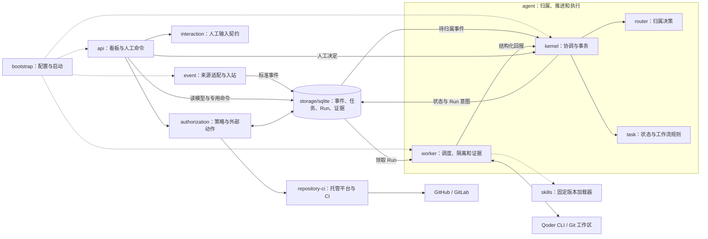
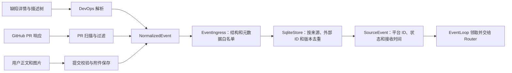
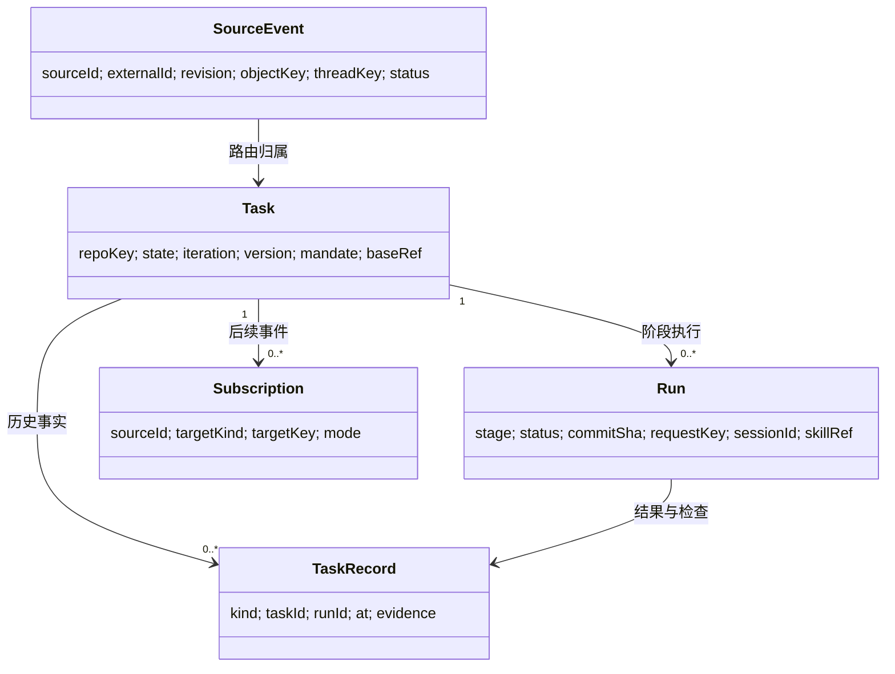
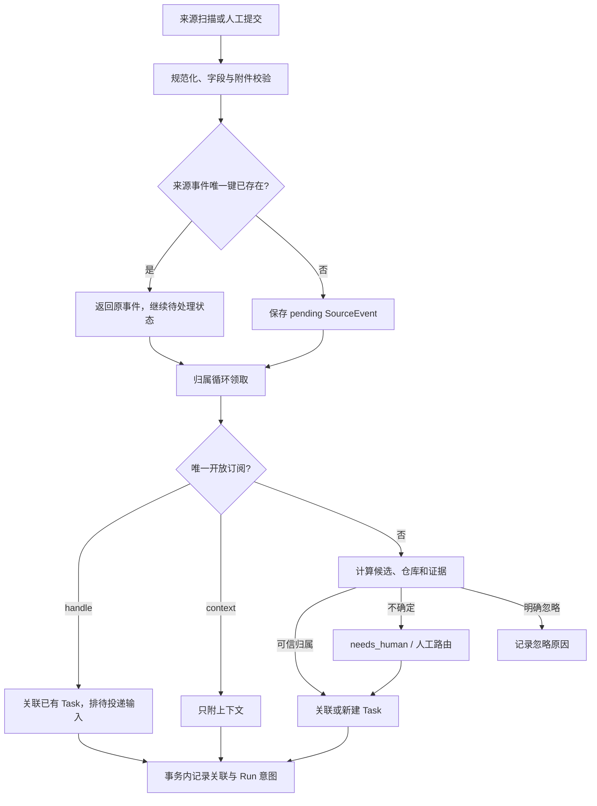
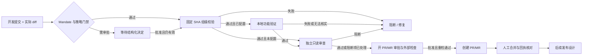

# Agent 自动化中台架构与功能设计

> 2026-11-24。依据《实施计划（讨论稿）》《需求/需求完善版（讨论稿）》及当前代码整理。本文解释系统为什么这样划分、各功能怎样协作，以及哪些能力仍需真实环境验证；实施顺序和任务清单留在实施计划中。

## 1. 目标、边界与设计原则

中台接收确定来源的 Bug 和开发任务，将其变成受授权约束的工作，协调 Agent 调查、开发、验证和审查，再把代码交付及人的决定串成一条可追溯的事实链。它面向单团队、少量受控仓库、一个本机服务实例；先保证每次动作可解释、可恢复、可审计，再考虑多实例或更高吞吐。

系统的核心是**控制面与执行面分离**：平台掌握事件归属、Task 状态、Mandate、审批和下一步；Agent 只在被授予的 Run 中调查或产生代码；GitHub/GitLab 与 CI 提供提交、检查和合并事实。Agent 的自然语言、CLI 对话中的“同意”、源事件正文和截图都属于不可信输入，不能直接成为授权或交付成功证明。

设计遵循六条原则：

1. **事实先于结论。** 事件、Run、提交、检查、审查、人的决定和外部回执分别记录；“运行成功”不自动等于“目标已解决”。
2. **授权跟随具体动作。** `TaskMandate` 确定来源、仓库、目标、允许动作、最大自动风险和策略版本；每次写入或外部副作用都在执行点复核。范围描述供人阅读，不能代替结构化 Mandate。
3. **固定版本再验证。** 开发产物以提交 SHA 和真实 diff 为准；检查、审查、审批、PR/MR、目标分支快照只对各自绑定的版本有效。
4. **局部失败可恢复。** 本地事务保存意图和幂等键，事务外调用 CLI 或外部平台；超时先查事实，不能确认就停下交人核对。
5. **扩展发生在边界。** 来源、Agent、代码托管和发布流水线按能力接口、稳定键与受信配置注册；两个内核循环不写产品专属分支。
6. **人决定风险，机器验证条件。** 人通过结构化入口批准、驳回或补充范围；平台负责检查角色、请求状态、Task 版本、SHA 与策略。人工批准不能替代隔离证明或平台检查。

## 2. 总体架构与模块设计

### 2.1 运行时结构与依赖方向

`bootstrap` 负责把配置与具体实现组装成一个运行实例。来源提供标准事件，内核决定归属与下一步，Worker 执行 Run，授权模块控制外部动作。SQLite 保存这些环节共享的事实。API 将事实整理为看板视图，并把人工输入送到内核或对应的用例。



实线表示主要运行路径，虚线表示启动组装或当前未启用的调用。各模块共用 `shared` 的基础契约，图中省略其依赖线。内核以 `KernelStore` 等接口隔离存储实现。Worker、看板 API 和交付用例目前仍直接依赖 `SqliteStore`，部分逻辑也直接查询 SQL。因此 SQLite 替换需要一起处理这些调用点。平台使用本机 SQLite WAL、短事务和 `run` 持久队列，CLI、网络与构建执行在事务外。

### 2.2 启动与依赖组装（`src/bootstrap`）

根目录的 `main.ts` 是服务组合入口。它读取环境变量指定的配置路径，获取数据库实例锁，再组装 Coordinator、WorkspaceManager、Worker、CodeHost 和本机 API，并启动各运行循环。`selfcheck.ts` 是独立自检入口，用内存数据库验证标准事件入库和去重。

#### `config/` 配置校验、仓库选择与适配器默认实现

`documents.ts` 读取本机 YAML 或旧版 JSON。`config.ts` 将平台配置校验并展开为 `PlatformConfig`，检查项目组、仓库和来源之间的引用。它定义按 `sourceId`、`agentKind`、`repoKey` 或 `repoKey + environment` 选择适配器的契约。`repository-selection.ts` 根据事件线索、项目组配置、本机路径和 Git origin 选择可信仓库。`ports.ts` 提供报告能力不可用的默认实现。

新增能力时，在这里校验配置和绑定键，在 `main.ts` 注册并注入具体实现。新增仓库匹配依据时，放到仓库选择器，并保持项目组范围和 Git origin 检查。

#### `schedules/` 定时调度与来源扫描

`scheduler.ts` 解析调度配置，管理定时触发、同任务防重入及停止时等待在途执行。`start-schedules.ts` 核对任务与项目组的关系，以调度项 `id` 注册事件来源和元数据白名单，再按 `kind` 绑定 `devops-task.ts` 或 `github-pr-task.ts` 中的处理器。处理器把来源数据交给统一 `EventIngress`。

新增定时扫描时，添加调度类型和处理器后，在 `start-schedules.ts` 注册来源种类、元数据白名单与处理器映射。处理器交付的数据沿用第 2.3 节的标准事件契约。

#### `credentials/` 外部服务凭据

`devops-credentials.ts` 读写 DevOps 凭据并生成 HTTP 请求头。`qoder-credentials.ts` 管理 QoderCN PAT。`code-host-credentials.ts` 维护按仓库或项目组保存的令牌，供代码托管适配器查找。配置保存与外部调用复用这些读写入口。

新增凭据类型时，在这里封装存储、校验和读取规则，由组装入口或对应外部适配器使用。若配置页需要支持更新，接入对应的写入函数，读取视图只返回配置状态。

#### `runtime/` 实例生命周期与运行维护

`instance-lock.ts` 获取数据库实例锁，保护同一数据库的启动与恢复过程。`startup-tasks.ts` 汇总启动检查、Agent 连接探测与清理结果，`prune-workspaces.ts` 按保留规则清理旧工作区。`worker-loop.ts` 驱动 Worker 的领取与轮询，在关闭时等待已开始的操作返回。

新增启动检查或维护任务时，将实现放在 `runtime/`，由 `startup-tasks.ts` 或 `main.ts` 接入对应的启动、运行或关闭时点。是否阻止服务启动由执行入口根据检查结果决定。

**从配置生成可运行实例。** 以一条 `devops-defect-poll` 配置为例，调度项的 `id` 成为来源 ID，`projectKey` 用于查出项目组，`businessProjectId` 和分页参数交给 DevOps 处理器。组装层把来源 ID 及其元数据白名单注册进仓储，并把处理器放入按 `kind` 查找的表。内核另收到该来源允许匹配的仓库集合。这样扫描参数、仓库范围和事件正文中的仓库线索有各自的来源。

### 2.3 来源接入（`src/event`）

- **结构。** `model.ts` 区分输入时的 `NormalizedEvent` 和持久化后的 `SourceEvent`，提供 `PollingSource`、`PushSource`、`AttachmentReader` 与 `EventRepository` 接口。DevOps 的 HTTP 请求、缺陷规范化及附件读取分别在 `sources/devops/client.ts`、`defects.ts`、`attachment.ts`。手工附件读取在 `sources/manual`，GitHub PR 扫描目前在 `bootstrap/schedules/github-pr-task.ts`。
- **运行路径。** 扫描器按来源协议拉取数据，`poll.ts` 对实现了 `PollingSource` 的来源逐页读取。来源处理器将标准事件交给 `createEventIngress` 校验结构和元数据白名单，再由仓储按来源、外部 ID 和版本幂等保存。附件以受控引用传递，由对应来源的读取器按需打开。
- **怎么扩展。** 新轮询来源实现标准化与分页，添加调度配置的 `kind`、来源注册与元数据白名单，再把处理器接入 `bootstrap/schedules/start-schedules.ts`。有附件时按来源注册 `AttachmentReader`。推送来源已有接口，后续还需接 HTTP 入口、来源校验和入站持久化。路由侧仍使用统一事件类型。

**不同来源如何映射到同一事件。**

| 来源与入口 | 来源侧处理 | 写入统一契约的字段 |
| --- | --- | --- |
| DevOps 缺陷，经 `devops-task.ts` 和 `sources/devops/defects.ts` | 分页取列表，再逐条取详情并核对缺陷及业务项目 ID。将描述树拆成正文和图片引用，对图片来源和地址做校验。 | `kind = bug`，`externalId` 和 `objectKey` 都取缺陷 ID。修改时间及标题、正文、附件等事实参与 `revision` 哈希。`repoKey` 可由仓库选择器给出。状态、优先级和选仓理由等放入白名单内的 `metaData`。 |
| GitHub PR，经 `bootstrap/schedules/github-pr-task.ts` | 按项目组逐仓库读取指向目标分支的开放 PR，过滤平台生成的任务分支，校验 head SHA。 | `kind = pull_request`，`externalId` 与 `objectKey` 为 `repoKey#PR编号`。用更新时间、标题、正文、head SHA、目标分支和草稿状态生成版本。填入仓库、链接及时间，保留 `prNumber`、`headSha`、`baseBranch`、`draft`。 |
| 人工提交，经 `POST /api/events` | 校验提交角色和仓库归属，检查并保存图片，计算正文及图片内容摘要。 | `kind = manual_task`，`sourceId = manual:<repoKey>`，`externalId = <actorId>:<idempotencyKey>`，`revision = 1`。标题取正文首行，附件用 `manual/<id>` 引用，摘要放 `metaData.contentDigest`。同一幂等键配不同内容会被拒绝。 |

下面是一条虚构的 GitHub PR 转换结果，SHA 和版本值为示意。它展示 `NormalizedEvent` 的实际字段命名。

```json
{
  "sourceId": "agent-platform-prs",
  "externalId": "agent-platform#42",
  "revision": "0123456789abcdef0123456789abcdef0123456789abcdef0123456789abcdef",
  "kind": "pull_request",
  "title": "修复任务分页",
  "body": "列表切换筛选条件时重置页码。",
  "objectKey": "agent-platform#42",
  "repoKey": "agent-platform",
  "url": "https://github.com/example/agent-platform/pull/42",
  "occurredAt": "2026-11-24T09:00:00+08:00",
  "attachments": [],
  "metaData": {
    "prNumber": 42,
    "headSha": "0123456789abcdef0123456789abcdef01234567",
    "baseBranch": "main",
    "draft": false
  }
}
```

`sourceId + externalId + revision` 标识一条可去重的来源记录，`objectKey` 和可选的 `threadKey` 用于跨版本关联。`sourceId` 给这些键划定命名空间，因此不同来源的同一个数字 ID 可以并存。附件数组保存 `id`、`kind`、`sourceRef`，可附带 `mimeType` 和 `expiresAt`。新事件通过校验后，仓储把它保存成 `SourceEvent`，补上平台 `id`、`receivedAt` 和初始 `status: pending`。后续领取和归属使用 `leaseUntil`、`routingData`。因此 Router 收到的是平台事件与标准关联键。



### 2.4 归属、协调与任务规则（`src/agent/router`、`kernel`、`task`）

| 子模块 | 代码如何组织 | 扩展落点 |
| --- | --- | --- |
| `router` | `candidate-finder.ts` 通过查询接口拿候选，整理来源标识、历史关联和文本证据。 `route-event.ts` 用候选和可信仓库输入得出归属决定。 `model.ts` 定义候选、证据与决定。 | 新匹配依据放候选查找器或归属规则。新增决定类型时，更新决定契约及内核对该决定的落库路径。 |
| `kernel` | `event-loop.ts` 领取待归属事件、处理订阅直通并提交归属。 `task-loop.ts` 生成归属计划、Run 排队意图及人工恢复所需的判断。 `coordinator.ts` 接收统一 `KernelSignal`，协调 Agent 回报、人工决定、效果回执和恢复，并经 `KernelStore` 提交状态与证据。 | 新来源或新 CLI 沿用现有事件和信号。只有新增统一的业务信号或协作步骤时，才更新 `model.ts` 与 Coordinator 的处理路径。 |
| `task` | `model.ts` 定义 Task、Mandate、订阅和 TaskRecord。 `transition.ts` 检查状态转换与重开。 `workflow.ts` 将 Run 回报和恢复事实转换为状态或下一阶段决定，由 Coordinator 执行。 | 新业务分支放工作流决策。新增阶段时需同步 Run 阶段、领取配置、结果证据、状态转换和历史数据读取。已有阶段上的新工具通过 Worker 适配器接入。 |

这三个模块分别回答“事件属于谁”“本次信号如何提交”和“任务接下来允许做什么”。例如人工回答恢复时，由 API 提交结构化回答，Coordinator 按当前请求及 Run 状态提交事实，随后由 Worker 投递或恢复 Session。归属和工作流规则不直接运行 CLI。

**一次归属和推进如何完成。** EventLoop 领取上述 `SourceEvent` 并查订阅，将事件、订阅、候选查询函数和来源允许的仓库传给 `routeEvent`。可信仓库无法确认时，返回带原因的 `needs_human`。匹配唯一、仍有效且有调查权限的 handle 订阅时，返回 `existing_task`、目标任务 ID 和订阅证据。没有可直接绑定的任务，且无候选、图片比对等阻挡条件时，返回带 `repoKey` 和 Mandate 的 `new_task`。随后 `planRoute` 把决定转换为写入计划，`commitRoute` 一次提交事件归属、任务、关联记录及需要排队的 Run。

后续 Worker 的 `agent_event` 进入同一个协调器。以 investigate 成功为例，`decideAgentEvent` 先校验 Task、Run、轮次和结果引用。Mandate 已有 `edit` 时，工作流决定进入开发并排 `develop`，否则返回等待人及范围审批的决定。工作流函数输出决定，协调器根据决定持久化状态、审批或下一条 Run。

### 2.5 Run 执行与校验（`src/agent/worker`）

- **执行协调。** `model.ts` 定义 `RunRequest`、`AgentRunner`、`AgentEvent`、结果证据与 `WorkspaceManager`。 `manager.ts` 负责领取、配额、输入投递、取消与恢复，调用工作区和执行边界，并把结构化结果交给 Coordinator。Qoder 的参数、CLI 日志和原生 Session 映射在 `agents/qoder.ts`，阶段提示词在 `agents/qoder/`。
- **隔离与项目构建。** `workspace.ts` 管固定 SHA 的 Git 克隆、副本、组快照和检查后的状态核对。 `mac-sandbox.ts` 提供 macOS/Qoder 的执行边界。 `group-verifiers.ts` 按 `projectKey` 注册 `verifiers/` 下的项目校验计划。CloudBOM 的 Maven 模块和测试选择由 `maven-modules.ts` 支持。组级 Java 校验使用本机 `JAVA_HOME`，其中 Maven 命令可使用 `MAVEN_SETTINGS`。
- **怎么扩展。** 新 CLI 实现 `AgentRunner`，将启动、会话恢复、进度、取消及结果归一到现有契约，在 `bootstrap` 注册，并提供可核验的执行边界。新增校验类型在 `verifiers/` 实现 `GroupVerifier`，由 `verification.type` 选择。项目组使用已有类型时只需登记本机配置。新增构建快照和模块选择语义时，再扩展 `WorkspaceManager` 或模块选择契约。跨 CLI 会话交接使用 Task 事实，原生 Session 仍归各自 Runner 管理。

**一次 Run 的输入与产物。** 领取 `develop` Run 后，Manager 读取 Task 的仓库、轮次、基线和 Mandate，准备工作区并校验执行证明。它组装 `RunRequest`，核心字段为 `taskId`、`runId`、`stage`、`mandate`、`repoKey`、`workspace`、`execution`、`input` 和 `timeoutMs`。其中 `input` 可是首次任务、来源补充或人的回答。适配器管理 CLI 进程与 Session。Manager 汇总结构化回报，开发结果中的 `development` 包含基线 SHA、新提交 SHA、diff 引用、检查回执与事后校验结论。校验、功能验证和审查分别使用 `verification`、`functionalVerification`、`review`，都以 `subjectSha` 标识受验提交。

### 2.6 Skill 版本化（`src/skills`）

`model.ts` 定义仓库引用、相对路径、提交 SHA、适用阶段和 `SkillLoader` 接口。 `git-loader.ts` 根据受信仓库映射从固定 Git 提交读文件。当前 `main.ts` 已组装加载器，但启动预加载和 Worker 的自定义 Skill 读取已暂停，Qoder 使用自身适配器中的阶段提示词。

恢复自定义 Skill 时，应在 Worker 的请求组装处接回加载器并记录实际版本。新增固定版本内容来源可实现同一个 `SkillLoader`，由启动代码注入。新增 Skill 适用阶段时同时更新阶段契约与选择逻辑。

**定位到内容的过程。** 调用方原本可传入 `repoRef / path / commitSha / stage`，加载器按仓库映射读取对应提交里的文件，返回 `{ content, ref }`。这个设计让一次 Run 采用的 Skill 内容可以用同一引用复查。当前请求中的 `skill` 是可选字段。

### 2.7 授权、风险与交付（`src/authorization`）

- **结构。** `model.ts` 定义效果请求、决定、授权策略端口及默认调查 Mandate。 `auto-pr.ts` 定义低风险自动开发通道的接单、路径和差异条件。 `policy/` 将策略配置、上下文、规则与求值分开，规则结果由 `evaluate.ts` 合并并审计。 `stage5-policy.ts` 校验交付动作的仓库、范围和风险，`stage5-open-change.ts` 承担开 PR/MR、外部状态读取、人工合并准备与回执核对。
- **怎么扩展。** 新通用校验在 `policy/hooks.ts` 注册并注明适用的 gate。新增策略配置时同步配置契约与审计字段。新增外部动作时，在动作契约、审批请求、证据与效果记录中表达身份和版本绑定，先持久化幂等意图，再经相应平台端口执行和核对回执。 `EffectGateway` 已有接口，当前实际 PR/MR 路径由 `createStage5OpenChange` 实现。

**一次开 PR 审批怎样变成外部请求。** 交付用例先读取任务轮次、Mandate、开发证据、受审提交以及目标分支事实。策略求值产出允许、要求审批或拒绝的结论。范围不足和外部动作待批对应不同请求，审批绑定源与目标 SHA 等条件。执行时再次核对这些事实，先保存效果意图及幂等键，再推分支并调用 CodeHost，最后核对并记录变更引用。下一模块负责把 GitHub 或 GitLab 响应转换为统一的变更事实。

### 2.8 托管平台、CI 与发布端口（`src/repository-ci`）

`model.ts` 定义 `CodeHost`、`ReleasePipeline`、变更快照和检查结果。 `providers/github.ts`、`providers/gitlab.ts` 将各平台结果映射为统一对象，`providers/http.ts` 处理请求、地址、凭据与 SHA 校验，`providers/index.ts` 按仓库创建实例。 `gate.ts` 根据平台快照判定配置要求的检查是否满足。创建变更和是否允许推进仍由授权用例决定。

接入新代码平台时，实现 `CodeHost`，扩展受支持的 provider 类型和配置校验，在工厂按仓库绑定，验证目标 SHA、检查结果与合并回执的语义一致。发布适配器实现 `ReleasePipeline`，以 `repoKey + environment` 绑定，并接入具备审批、意图与回执的用例。目前已有发布契约和选择函数，尚无实际发布执行链路。

**如何形成统一的合并判断输入。** 查询同一个变更时，provider 根据仓库配置把外部 PR/MR 标识映射为带 `provider`、`repoKey`、源 SHA 和目标 SHA 的 `ChangeRef`。`readChange` 返回 `ChangeSnapshot`，其中的变更状态、检查及平台门禁事实用于后续判断。 `checksReady` 按配置要求核对检查，交付用例再结合受审 SHA 与审批决定是否可以推进。

### 2.9 人机契约与 API（`src/interaction`、`src/api`）

- **契约。** `interaction/model.ts` 定义问题、回答、人工归属、审批和重开。 `interaction/task-command.ts` 定义任务命令的判别联合，以及版本和幂等键。它们给 API、内核和仓储提供可校验的数据形状。
- **接入。** `api/local.ts` 提供本机 HTTP、静态资源、看板来源校验与独立交互 API 的 Bearer 校验。 `dashboard.ts` 负责列表、详情、证据过滤与命令分发。 `task-command.ts` 处理暂停、恢复、取消等专用用例，直接通过仓储提交合法转换。 `settings.ts` 展示启动配置快照、文件变更和凭据状态，凭据更新由对应文件模块原子保存。
- **怎么扩展。** 新查询在 `dashboard.ts` 增加受控读模型。新人工操作先定义结构化契约，再接 HTTP 校验、服务端身份与角色、版本和幂等检查，最后分发到 Coordinator 或专用用例。新配置项加入本机配置模型和校验契约。设置页显示当前值，配置通过文件更新。

**一次回答如何流转。** 看板将问题标识及内容提交给回答端点。API 校验任务、预期版本、角色和输入，从服务端配置取得 actor，然后生成含 `questionId`、`actor`、`content`、`idempotencyKey` 的 `answer`。Coordinator 接收 `human_response`，仓储核对当前问题与 Run 并持久化。Worker 使用对应 Run 和 Session 投递。保存成功与 CLI 实际处理回答是两个分别记录的事实。

### 2.10 持久化与共享模型（`src/storage`、`src/shared`）

- **持久化。** `storage/sqlite/store.ts` 负责 schema 校验、迁移、参数化查询和事务。 `migrations/` 建立表及约束。入站去重、事件租约与归属提交、Run 领取、审批和交付回执依赖这些事务边界。 `task_record` 用结构化事件留存证据，核心索引支持当前队列和任务查询。
- **怎么扩展。** 新增索引、持久字段或表时追加迁移，验证旧数据库升级与旧记录读取，再更新查询和调用方。替换数据库时先补齐 Worker、API 和交付用例仍在使用的直接 SQL 边界，并保留原子领取、去重、审批和版本约束。
- **共享模型。** `shared/model.ts` 只放 ID、时间、操作者、证据引用与失败等基础契约。新增领域字段优先放入所属模块，只有语义一致且需要跨模块共享的基础结构才放在这里。

**一次事件的持久化过程。** 重复入站以来源、外部 ID、版本返回已有事件 ID。领取时写归属状态和租约。提交归属时在同一事务中更新事件，并按决定写 Task、事件关联或待执行 Run。 `dashboard_command` 独立保存看板命令的幂等结果。各表的约束把模块间约定落实到写入点，使得重扫、重试和进程恢复可以复用已保存的事实。

## 3. 核心领域模型：Event、Task、Run、Session 与证据



`SourceEvent` 是一次来源通知的标准事实，`Task` 是一项被授权的业务工作，`Run` 是该任务某个阶段的一次执行，`Session` 是某个 CLI 的原生对话标识。Task 可有多个 Run；同一个 Session 不得有两个活跃进程。跨 CLI 不能续用对方的 Session。`TaskRecord` 保存结构化证据和人工决定，不能用一段 Agent 总结覆盖多种事实。

首期主表为 `event_source`、`source_event`、`task`、`subscription`、`run`、`task_record`；后续迁移增加 `dashboard_command` 等辅助表。事件唯一键 `(source_id, external_id, revision)` 阻止重投生成重复 Task；Run 的 `requestKey` 抑制重复排队；Task 的 `version` 防止看板基于过期状态修改。订阅的 object/thread 键只在同一来源命名空间中比较。业务操作在 SQLite 事务中同时写状态、关联和记录，避免“状态已变但证据未存”的半成品。

Task 状态与阶段相关，但并非一条没有分支的流水线：等待回答、审批、失败、重试、审查修复和已结束任务的关联调查都可能改变下一步。状态机在 `src/agent/task` 中验证合法转换；Router/Coordinator 接收结构化信号后生成下一 Run 意图，Worker 不直接改状态。`Mandate` 随 Task/iteration 保存，重开旧 Task 不能继承旧审批或把旧工作区当成新授权。

## 4. 功能流：来源接入、归属与关联



来源适配器负责认证、分页、原始字段映射和错误处理；`EventIngress` 只接受已注册且启用的来源，并对白名单外 `metaData` 字段拒绝入库。图片只保存受控引用，Worker 通过 AttachmentReader 再校验来源、大小、媒体类型和访问权限。中文描述与截图可以形成代码线索，但截图观察与推测要标明依据；没有复现、调用链、日志或版本比较时不能把候选文件称作根因。

扫描任务按 `sourceId` 防重叠，成功完成整轮后才提交游标；失败后下轮重扫由唯一键消重。订阅直通同一 Bug/话题的新事件，可省去重复归属判断，但不能省去持久化、授权及投递确认。`handle` 事件唤醒任务，`context` 事件只补事实；忙碌 Session 的输入排队，送达不确定时不自动重发。

路由依据来源键、明确旧任务引用、仓库和轻量线索找候选；**文字相似仅能提示人**。仓库选择先核对项目组允许的仓库、私有 `searchRoot`、本地路径和 Git origin；明确唯一线索或受信默认仓库才能自动选。人工选择有理由、版本和幂等记录。已结束任务的新反馈先建关联调查 Task，使用当前基线的新工作区和有界历史事实；Qoder 跨独立克隆不假设能恢复原 Session。只有关联调查证明复现或同范围回归，有 `reopen` 角色的人才可提交绑定 Run、报告、SHA 与旧 Task 版本的重开决定；独立问题继续作为新 Task。

## 5. 功能流：Worker、工作区与 Agent

`WorkerManager` 从持久 Run 队列领取作业，按全局、仓库、Agent 配额及 Task/工作区/Session 互斥派活。人的回复优先于新任务，保留等待任务恢复名额。一次 Run 绑定阶段、Task iteration、基线或受审 SHA、Agent、Skill 版本和工作区；启动前检查能力与隔离证明。当前 Qoder 是实际注册的 CLI；CodexRunner 仍为后续适配目标，不应在内核中加入 CLI 名称分支。

首次调查克隆受信 `localPath`；后续阶段从已核验的基线或开发提交创建每 Run 独立副本。macOS 的 APFS clonefile 只用于加速，身份、origin、固定 SHA、`.git` 状态与权限仍须逐次核对。Skill 从指定 Git commit 读取 `SKILL.md`，由人维护、评审，显式放入 RunRequest；缺失或版本不符则阻止执行。原生 Session 仅在同一 CLI、同一可验证上下文内复用，跨克隆或跨 Agent 使用新 Session 加结构化交接。

调查需要真实只读边界；开发需要 edit Mandate、授权范围内的写入边界和专用 Qoder PAT。隔离失败、能力未知或越界时暂停，不把提示词当成沙箱。开发进程结束后检查提交、非空 diff、变更路径、工作区状态和证据引用，才将结果交给内核。Worker 回报进度、问题、结果、检查和用量；内核决定 Task 状态及下一 Run。

租约过期不能证明旧 CLI 进程已退出。Run/Session 状态不明时停下；`processTerminationUnconfirmed` 阻止第二个进程，人工确认终止后才可重试。无法确认回答是否送达也停下核对。用量无法取得时记 unknown，并用时长/次数上限兜底。启动时检查 Agent 连接；过期克隆清理只处理已终结且没有活跃 Run 的任务，以及超宽限期的检查副本。

## 6. 功能流：验证、功能观察、审查与交付



### 6.1 三种不同的验证事实

开发时的局部检查用于尽早反馈；组级验证针对确定的开发提交；代码托管平台 `requiredChecks` 针对变更请求的源/目标版本。三者不能互相冒充。项目组通过 `verification.type` 选择校验实现。npm 在隔离副本安装依赖并执行配置声明的检查。Maven 可在单仓库执行 `verify`，也可对跨仓库快照按固定 Git 差异选择模块和本次新增或修改的测试。旧布尔配置通过兼容读取器转换。未启用组级校验时跳过 verify 并要求人工交付决定。每项检查记录命令、参数、SHA、退出码、日志、终止确认和事后 Git 状态。

可选 `functionalVerificationUrl` 在组级验证后安排独立只读 Agent Run，通过本地服务观察任务目标。它报告通过、失败或无法验证；失败可返回开发修复，无法验证转人工。若 Run 异常停止，仅在进程确认结束且固定 SHA 校验仍通过时，允许对该 Run/轮次/SHA 提交跳过功能观察的审批。功能观察不保证本地服务一定运行受审提交，部署版本仍需人工核对。

### 6.2 审查与有限修复

Review 用新的只读 Run/Session 读取需求、diff、邻近代码及检查摘要，给出绑定 SHA 的结构化结论、文件/行、证据、影响和验证方法。`block` 或高/未知严重度意见阻断；有具体意见的自动修复最多两轮，空意见的 block 只可在人确认后按原 SHA 重试。阻断意见需要修复，或由有权人发布并逐条做“接受风险/误报”决定。原始 Agent 审查内容不直接成为看板上的已验证结论；新 commit、轮次或审查记录使旧处理失效。

### 6.3 范围、风险、PR/MR 与合并

统一策略入口 `src/authorization/policy` 对 intake、edit、develop-complete、openPr、merge 等门求值。内置不变量、变更规模、敏感内容和配置门结果取最严格的 `deny > require-approval > allow`；钩子异常按 deny。`off/shadow/warn/enforce` 区分关闭、只审计、警告和强制拦截；策略指纹与决策写审计。Mandate 与阶段五门禁仍分别校验仓库、目标、实际 diff、风险和动作审批。仓库专属路径语义和更细规则可在受信配置中扩充，不能把通用层写成某仓库目录清单。

低风险自动开发通道只在仓库配置显式启用、人工来源明确要求改代码、路径/diff/固定 SHA 校验/审查均满足时，生成**开 PR/MR 的动作审批**。审批前不能推分支。批准后重新读取源提交、目标分支 SHA、保护规则和真实 diff，先写效果意图及幂等键，再推分支、创建变更请求并核对回执。`AGENT_PLATFORM_STAGE5_WRITES_ENABLED` 单独控制外部写入；缺少令牌或隔离证明时停下。GitHub/GitLab CodeHost 按 `repoKey` 绑定，不能用同 provider 的别仓库实例替代。

合并前复查受审 source SHA、最新 target SHA、必需 CI、平台状态、未处理阻断意见和有效批准。当前没有能原子固定目标 SHA 的自动合并模式，因此只形成**人工合并意图**；平台随后核对真实合并回执及提交双亲，才推进任务。创建 PR、检查通过或发送合并请求都不等于合并成功。目标变化、冲突、检查失败、超时或结果不明时重新核验或交人处理。外部写入与合并的真实端到端能力仍须用选定仓库和受限凭据演练。

## 7. 人机交互与看板设计

看板是常规操作入口：首页优先呈现待回答、待审批、失败/阻塞和运行容量；任务详情把来源、关联、Mandate、Run/Session、提交、检查、审查、批准和交付历史组织为可追溯视图。人工提交先选项目组，可由系统安全选仓或指定组内仓库；配置页显示生效配置并提供凭据更新入口。令牌写入本机受限文件，读取接口只返回凭据状态。所有命令携带幂等键和预期 Task 版本，服务端以当前事实重新校验；前端只展示回执，不用乐观状态替代事实。

当前看板及其 `/api/*` 请求不要求输入 API 凭据；服务限 `127.0.0.1`，看板 API 校验本机 Host 和浏览器 Origin，角色由服务端配置。**这是一人本机控制台的信任边界，不是多人身份系统**：同机能访问端口的进程可按配置角色操作。独立交互 API 仍要求 Bearer 凭据，actor 由服务端确定，客户端不能自报角色。回答、审批、路由、重开、审查发布、配置变更和任务命令各有自己的校验。

常规任务命令包含暂停、恢复、重试、取消、标记完成和进程终止确认。新“拆分任务”和新“人工接管”已从页面移除，服务端拒绝新请求；历史上已接管的 Task 仍可提交接管结果以完成收尾。人工路由和有证据的重开承担关联决策。看板不直接暴露来源凭据、本机工作区路径或未经核对的 Agent 原始审查文本；受控图片、diff、日志及审查摘要分别按权限和证据状态呈现。原生 CLI 会话引用可供人核查，不能把其中自由文本当成批准。

## 8. 发布、扩展与运行保障边界

发布是独立于合并的业务动作。代码中已有按 `repoKey + environment` 选择 `ReleasePipeline` 的契约，真正的受限发布适配器、执行和回滚闭环尚待落地。设计上，发布请求须绑定合并 SHA、目标环境、不可变制品/版本、流水线配置与参数摘要；生产发布单独审批。可选只读 `release_prepare` Run 整理风险、检查清单和回滚入口，不持生产凭据。效果网关先写意图，再调用流水线并核对实际部署版本和发布后检查；状态不明不重复触发。回滚保留原发布事实，已关闭任务的回滚另建关联应急 Task 与授权。

CodexRunner 按同一 `AgentRunner` 契约接入前，需实测选定 CLI 版本的 Session、取消、图片、结构化结果、Skill 注入和用量。跨 Agent 仅交换有界、标明来源的 Task 事实，不迁移原生对话。IM 推送、其他来源和新托管平台也遵守对应能力接口，不改两个内核循环。发布后的反馈重新进入统一事件和关联调查路径，不能因为时间接近就断定旧修复回归。

运维上，启动校验配置、数据库独占锁、Agent 连接与可恢复事实；运行中观察来源积压、Run 队列/预算、等待人时间、终止状态和外部不确定效果。数据库、日志和工作区采用私有目录与保留策略，日志去敏；重启和超时优先查旧进程/Session、变更请求和外部回执。多实例、消息代理、独立 Watchdog 与自动生产发布均由真实吞吐、故障和授权能力决定，不提前纳入当前执行边界。

## 9. 当前实现与验证界线

事件、Router/Task/Run、Qoder 接入、本机看板、组级验证、功能观察、独立审查、策略门禁、GitHub/GitLab 适配及人工合并回执路径已有代码。能否实际执行还取决于项目组配置、阶段五 Worker 与写入开关、专用凭据和外部保护规则。DevOps 真实鉴权、Qoder 写模式、真实固定 SHA verify/review、受限代码托管写入和真实 PR/合并回执，须分别查看运行证据；本地测试不能替代。发布执行、回滚与 CodexRunner 仍是架构设计，不应描述为已完成能力。
