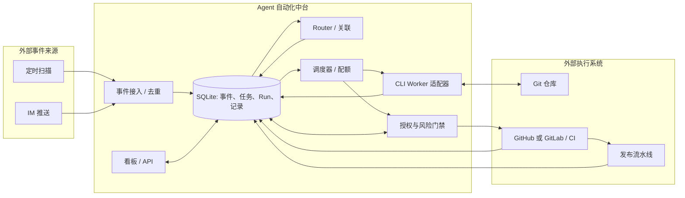
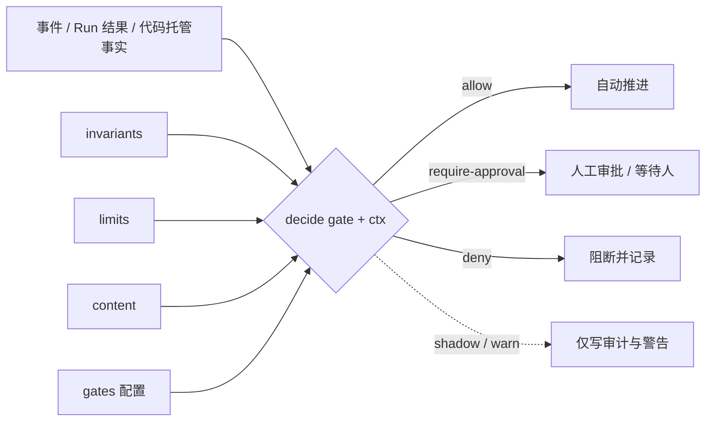

# Agent 自动化中台架构设计（讨论稿 v1.1）

> 2026-11-03，2026-11-12 增补第 4、5、6.1、8 节（统一校验策略、develop 证据门禁、终止确认语义）。对应《需求/需求完善版（讨论稿）.md》。本文记录实现方案与首期技术决策，不把 DeepSeek 原型已有能力等同于中台已实现能力。具体来源、仓库、CI 与审批人待业务方选定后配置。

## 1. 设计边界与决策

首期按**单团队、少量仓库、一个平台服务实例**设计。平台持有事件、任务、运行、授权和审批的事实；CLI Agent 持有原生对话；代码平台与 CI 持有提交、检查、合并、发布的事实。看板只经平台 API 操作，不能用 Agent 的自然语言输出直接改变审批状态。

内核封装在 `src/agent/kernel`，只运行**事件归属循环**与**任务生命周期循环**：消费统一事件、Worker/人的结构化回报和外部动作回执；处理订阅直达、候选归属、Task/Run 状态、派活、挂起/恢复及幂等记录。内核执行侧的通用 `WorkerManager` 管理配额、租约、Session/工作区互斥，并在每次执行前经 SkillLoader 加载本阶段 Skill，构造统一 RunRequest 交给已选 AgentRunner。内核不解析来源原始数据、CLI 输出或代码平台响应，不检索/修改代码，不知道 Qoder/Codex 的命令参数，也不实现 CI、PR/MR、合并和发布 API。跨系统动作由授权门禁与已注册适配器执行；内核只消费经校验的统一结果。

“插件”在首期指 `bootstrap` 中按能力接口显式注册的**进程内适配器**：事件来源按 sourceId，AgentRunner 按 agentKind，已绑定仓库的 CodeHost 按 repoKey，ReleasePipeline 按 repoKey/环境选择。每类适配器负责自身协议、凭据、错误映射、能力探针与外部事实核对；未知键和不支持的能力显式失败，不回退到另一个仓库或 CLI。增加一个来源、CLI 或代码平台应只增加适配器、配置和契约测试，不修改两个循环；首期不建设动态插件市场或通用 Plugin 基类。

| 问题 | 首期决策 | 升级条件 |
| --- | --- | --- |
| 中台语言与界面 | TypeScript/Node.js；阶段 4 用 React + TypeScript + Vite 建看板，按需复用 shadcn/ui 组件；沿用原型的交互原则，按新领域模型实现 | 团队现有服务规范要求其他栈时调整 |
| 数据库与队列 | SQLite（WAL）；`run` 是持久作业队列，单个调度进程租约领取 | 多主机调度或数据库写入成为瓶颈时改用 PostgreSQL；只有跨服务高吞吐分发确有需要时再加消息代理 |
| 代码托管 | 每个仓库配置 `provider=github/gitlab`，由对应适配器实现统一 `CodeHost` 契约 | 新平台增加适配器和能力测试，不改 Task/Run 领域模型 |
| CLI Agent | Codex、Qoder 各自适配器，以子进程和原生 Session 接口接入 | 先完成版本与能力探针；不可用能力不模拟为已支持 |
| 工作区 | 每任务每轮独立 Git worktree/分支，从配置的基线创建 | 目标代码平台要求远端执行时改为等价隔离工作区 |
| 来源与附件 | 首期定时扫描指定页面；IM 推送及 GitHub/GitLab Issue 发现保留适配接口；原始元数据与附件引用入库，运行时按权限获取图片 | 来源不能稳定保留附件时增加受控对象存储 |
| 验证与交付 | 调用仓库现有测试命令、代码托管 API 和既有 CI/发布流水线 | 不自建 CI、发布引擎或通用工作流编辑器 |
| 看板更新 | 短轮询 API，数据库为准 | 交互延迟成为实际问题时再加 SSE |

不用独立 Message Bus：事件写入数据库后由 Router 领取，Router 将 Run 入队，Worker 按配额领取。数据库事务、租约和幂等键已经覆盖解耦、限流及重启恢复。`run` 同时保存作业和执行事实，无须再加 `job` 表或按开发/测试/审查拆三套队列。

TS 通过 Node 的 `node:sqlite` 直接执行参数化 SQL；首期这六张表和明确的事务边界不需要 ORM。事件去重、任务关联、Run 领取等写操作保持短事务，CLI 调用、网络请求、图片处理和 CI 等待必须在事务外异步执行。`DatabaseSync` 是同步 API，不能在请求主线程里做长查询或大批量写入；用索引、分页和批量上限控制耗时。SQLite WAL 允许读写并行，但同一时刻仍只有一个写者，数据库文件应放本机持久磁盘。阶段 3 正式启动入口在打开 SQLite 前用 macOS `lockf -t 0 -k` 取得数据库对应的独占锁，并由包装整个服务进程的锁持有者在数据库关闭后释放；未取得锁的实例不得启动扫描、恢复或派活。旧 Qoder 进程状态不明时还须单独阻止自动派活，单实例锁不能证明它已结束。若未来需要多个服务实例共同写入或写入等待持续升高，再把持久层迁移到 PostgreSQL，并保留相同的业务事务与幂等语义。

`repo_key` 是平台内稳定仓库标识，部署配置为每个仓库存 `provider`、平台地址、平台侧项目引用、默认目标分支、必需检查和凭据引用，不增加业务表。组合入口按 `repo_key` 选择已绑定该仓库的 GitHub 或 GitLab `CodeHost` 适配器，不能仅按 provider 复用未绑定仓库的实例；适配器把 PR/MR、检查/流水线和合并结果转换为统一对象。来源适配器单独配置：Bug 可以来自 IM 或其他平台，再指向任一 GitHub/GitLab 仓库；不能从事件来源推断仓库托管平台。

### 1.1 代码模块边界

| 路径 | 职责 |
| --- | --- |
| `src/shared` | 跨模块共用的 ID、时间、操作者/证据引用和错误类型；不承载业务流程。 |
| `src/event` | 来源适配、原始数据规范化、`EventIngress`、去重；不创建 Task。首期页面来源实现放 `event/sources/page`，后续 IM 与 GitHub/GitLab Issue 适配器也放 `event/sources`。 |
| `src/agent/kernel` | 两个循环的协调入口：统一信号、订阅直达、Task/Run 派活、挂起与恢复；只依赖领域类型和端口。 |
| `src/agent/task` | Task、Subscription、TaskRecord、状态与任务用例。 |
| `src/agent/router` | 标准事件的归属规则与候选证据；不直接读来源 API 或完整代码。 |
| `src/agent/worker` | Run 队列、资源调度、AgentRunner 端口、Session/工作区；Qoder/Codex 实现放 `worker/agents`。 |
| `src/interaction` | 结构化问题、回答、审批请求与决定，供 Worker 与看板共用；审批有效性由 `authorization` 检查。 |
| `src/authorization` | Mandate、风险策略、审批和外部动作门禁；`policy/` 是统一校验策略的求值入口（review 配置、钩子、决策与审计）。 |
| `src/repository-ci` | 代码托管、检查、PR/MR、合并与发布契约；GitHub/GitLab 实现放 `repository-ci/providers`，发布流水线适配放 `repository-ci/release`，与 Issue 来源实现分开。 |
| `src/storage/sqlite` | SQLite 连接、事务、迁移和各模块仓储接口的实现；不放路由或风险决策。 |
| `skills/` 与 `src/skills` | 前者是人维护的阶段 `SKILL.md`，后者是运行时选择、读取和记录版本的加载器。 |
| `src/api` | 阶段 3 提供结构化交互 API，阶段 4 增加列表/详情视图与看板命令入口；不代替 Router 决策。 |
| `web` | 阶段 4 建 React 看板；`web/skills/shadcn` 存人工审阅的前端开发 Skill，不进入运行时 SkillLoader。 |
| `src/bootstrap` | 配置与依赖组装。 |

业务模块声明自身需要的仓储/外部能力接口，`src/storage/sqlite` 和外部适配器实现接口，`src/bootstrap` 按实例身份注册并注入；内核和业务模块不导入 SQLite、具体 CLI 或平台 SDK。默认阶段 Skill 放平台仓库根 `skills/{investigate,develop,verify,review,release}/SKILL.md`，由人评审；目标仓库需要专属 Skill 时由配置指定其版本化路径。`run.skill_ref` 记录所选 Skill 的仓库、路径和 commit SHA。平台不会自动生成或修改 Skill，也不把 CLI 的隐式自动发现当成已验证的加载方式。



## 2. 事件层

### 2.1 来源适配与统一事件

来源按能力实现 `PollingSource.read(cursor)` 或 `PushSource.verifyAndNormalize(raw, headers)`，各适配器内部将原始对象 `SourceNormalizer.normalize(raw, trustedConfig)` 为统一的 `NormalizedEvent`；不强制一个带空方法的抽象类。来源身份、类型、配置引用和启停由平台配置管理，扫描范围与频率由定时任务配置管理，凭据只以受信模块或引用注入；`event_source` 保存来源身份、启停和可选游标。Webhook 先验证来源签名/身份；首期定时扫描指定页面，按目标页面的加载方式、游标和访问限制运行；后续来源按各自协议实现。统一 `EventIngress` 再校验、去重并持久化成 `SourceEvent`。Router 和后续层只读取标准 `SourceEvent` 与必要引用，不接触页面、GitHub/GitLab 或 IM 原始 payload 及构建细节。来源原字段经筛选放 `meta_data`；附件 ID/安全引用经 `AttachmentRef` 校验后放标准 `attachments` 字段（数据库 `attachments_json`）；数据库不存图片二进制。

`NormalizedEvent` 最少包含 `source_id`、`external_id`、`revision`、`thread_key?`、`object_key?`、`repo_key?`、`kind`、`title/body`、`url`、发生时间、`attachments` 和 `meta_data`；持久化后的 `SourceEvent` 再增加平台 `event_id`、接收时间和路由状态。`external_id` 标识本次通知，`thread_key` 标识评论串，`object_key` 标识来源 Bug/Issue 等业务对象。后两者在 `source_id` 命名空间内匹配；不同系统的数字 Bug ID 不能直接相等。若来源只给 Bug ID，需结合更新时间或内容版本生成稳定 `revision`；同一投递必须生成同一键，正文相同的两个独立报告不能合并为一个事件。

### 2.2 去重、确认和重试

1. 将 `(source_id, external_id, revision)` 设唯一键；重复插入返回原事件 ID。原事件若仍为 `pending`，仍可由 Router 领取。
2. 扫描发现的事件可逐条幂等入库；只有整轮页面扫描完成后才提交新游标。Webhook 在后续接入时于事件落库后确认。崩溃后重扫/重投由唯一键消重。
3. 新事件为 `pending`。Router 用限时租约领取；归属不明时记录 `needs_human` 和类型化候选理由。路由成功后在**同一事务**完成任务关联、必要的 Run 入队和事件 `done`。租约超时后可重试。
4. 外部推送、创建 PR、合并、发布不能靠数据库事务保证恰好一次；先写带幂等键的待执行记录，执行前查询外部事实，成功后写回回执。无法查询或无法提供幂等键的动作转人工确认，不盲目重试。

### 2.3 定时任务与来源组装

`src/bootstrap/scheduler.ts` 从 `config/schedules.json` 加载任务，字段为 `id/kind/enabled/intervalSeconds/runOnStart/parameters`；`src/bootstrap/start-schedules.ts` 按 `kind` 选择已注册任务处理器，把受信来源、凭据提供器和 `EventIngress` 组装起来。启动前校验任务 ID、任务参数、`sourceId` 对应的来源类型、`configRef`、启停状态和可选 `repoKey`；同一来源不能配置多个有效扫描任务。当前 DevOps 来源在启动组装时执行这项检查；新增轮询来源时必须沿用按 `sourceId` 串行的约束，不能仅依赖调度器按任务 ID 防重叠。未注册或已禁用来源的事件在 SQLite 入库处再次拒绝。

调度器按任务间隔触发，单个任务尚在运行时跳过本次触发；不同来源可并行扫描。单轮分页读取和逐条入站在 `src/event/poll.ts`，来源协议及规范化在 `src/event/sources/*`，不进入内核。任务失败经统一错误回调报告，下一轮继续；停止时清除定时器、等待正在执行的扫描结束，再关闭数据库。首期修改 JSON 配置后重启生效，不提供运行时热更新。`config/schedules.json` 控制扫描任务，`config/platform.json` 控制受信来源身份；两者不能互相替代。当前 DevOps 适配器尚未通过真实接口与鉴权验收。

### 2.4 中文描述与截图

适配器确保原文、图片引用和读取权限可用；Worker 经来源的 AttachmentReader 复核授权、大小和媒体类型后，交给具备视觉能力的 CLI 读取截图，必要时 OCR 抽取可见文字、错误码、URL、界面状态。每条观察记录图片引用及位置，推测单列为假设。Router 可使用错误码、项目、Bug ID 等轻量线索关联；代码检索和根因验证属于 Worker。附件失效或仓库未知时形成具体待补充问题。

## 3. Router：全局协调层

`src/agent/kernel` 中的 RouterCoordinator 是持续运行的协调入口，封装事件归属与任务生命周期两个循环，不依赖单个长期 CLI Session。它维护持久的全局任务视图，对外承接人机交互，对内将 Task 的下一步转换为 Run。模型可辅助模糊事件判断，但规则、授权、状态转换和排队由代码与数据库约束执行。借鉴 DeepSeek 原型的订阅直通、Ticket 与 Assignment 分离、Worker 向主入口汇报；本平台用 Task/Run/Session 分离支持多仓库和相关任务的安全会话复用。

| 子模块 | 输入 → 输出 | 持久化责任 |
| --- | --- | --- |
| EventRouter + TaskCandidateFinder | SourceEvent → existing_task / new_task / needs_human / ignored | 只计算候选与理由；不写库 |
| RouterCoordinator | pending 标准事件、Worker 回报、人决定、外部动作回执、恢复信号 → 调用路由与流程 | 同事务提交事件状态、归属、TaskRecord 和 Run 意图；不调用具体 CLI/代码平台 API |
| TaskWorkflow | Task + Mandate + 信号 → 下一步命令 | 通过 transitionTask 写合法状态；不启动进程 |
| InteractionService | 问题/回答/范围变更/人工路由 | 结构化记录和对人呈现；不得从 CLI 文本生成批准 |

订阅直通的具体路径：SourceEvent 用 (sourceId, objectKey/threadKey) 命中唯一开放 handle 订阅 → 校验仓库与 Mandate → 同事务写 TaskRecord.event_link(handle=pending，context=recorded) 并完成事件路由 → WorkerManager 从该 Task 的待投递记录构造 AgentInput.source_followup(eventId) → CLI 确认后更新 delivered，只有经校验的 AgentEvent.input_handled 才更新 handled。一个 Task 同时命中 object/thread 时只建一条 event_link，以 handle 为准。context 订阅只附证据不唤醒；waiting_human 暂存自动输入；同一 Task 的突发输入合并到已有 queued Run 的待投递记录，不逐事件启动 Run；发送结果不确定则标 uncertain、停止自动重发。超范围由 Worker 发出经校验的 AgentEvent.handback，Router 排除原 Task 后重新判断。订阅直通只省去重复归属研判，不省去持久化、授权与失败恢复。

RouterCoordinator 同时处理两类循环：事件归属，以及 Worker AgentEvent / 人的 HumanResponse / 外部动作回执驱动的 Task 生命周期。排 Run 时按阶段、仓库、附件需求、已注册 AgentCapabilities 和预算选择 agentKind/优先级；阶段 3 仅注册 Qoder，能力不足时待人处理。Worker 不能直接改 Task 状态、排后续 Run 或向人发布已验证结论。Task 是授权工作的生命周期，Run 是一次阶段执行，Session 是 CLI 上下文；等待人、失败和恢复都分别记录。TaskWorkflow 为工作流信号生成稳定 Run.requestKey，run 表对非空 request_key 设唯一约束；重试不重复入队，人工明确重试产生新信号。

### 3.1 已结束任务的相关问题

同一 objectKey/threadKey 或明确旧任务引用可强关联，时间或文字相似只能成为候选。关联新 Task 可优先尝试旧 Session：先锁 Session，核对 Agent/版本、仓库、当前基线和工作区兼容性；在当前基线的新工作区续用。失败时新 Session 注入结构化交接摘要。复用 Session 不继承旧授权、审批或旧工作区。

阶段 3 的关联调查使用当前基线的独立克隆和新 Session。WorkerManager 从同仓库旧 Task 构造有界交接事实：标题、范围、轮次、基线、可信开发记录，以及可读取的历史 Run 结论和引用；Agent 结论标为未经独立核实。旧 Mandate、审批和工作区不进入新调查的授权。已有交接证据无法校验时待人处理。

调查证明原故障复现，或旧修复引发且仍在原范围内时，由具备重开角色的人提交绑定关联调查 Run、报告、SHA、判断、Task 版本与幂等键的决定。RouterCoordinator 在一个事务中校验同仓库父子关系、证据与运行状态，重开旧 Task 并增加 iteration，清空旧基线，收紧为 investigate 权限，取消关联调查 Task，转移事件待投递输入与 handle 订阅，并排新调查 Run。原发布、审批和调查记录保留；关联 Task 的未决范围审批失效并记下重开引用，不再进入人工收件箱，迟到批准被拒。新 Run 注入关联调查结论与引用，无法校验时停下待人处理。独立问题或超范围继续作为关联新 Task；证据不足只记“相关待调查”。

## 4. Worker：执行与资源管理层

RouterCoordinator 只写持久 Run 意图；WorkerManager 在事务外执行。run 表是队列与执行记录，不设独立 Message Bus。RunScheduler 在事务中领取有已注册能力的 queued 阶段；首期只运行 investigate/develop，阶段 5 接入后才领取 verify/review，阶段 6 可按需领取只读 release_prepare。合并、部署和回滚由 EffectGateway 执行并记录回执，不占 Worker Run。全局、仓库、Agent 账号配额和 Task/工作区/Session 互斥在领取时检查；人的回答优先于新任务，保留一个只供等待中 Task 恢复的执行名额；等待人答复期间不占执行名额。

WorkerManager 经工作区端口准备独立 worktree、加载阶段 Skill、构造 RunRequest、按 agentKind 调用 AgentRunner、续租、取消及恢复。QoderRunner 是首个真实适配器，Codex 后接同一接口。CLI 原始输出只在适配器转换为 AgentEvent；进程结局和产物校验后才能算成功。Worker 回报进度、问题、结果与用量，内核再决定 Task 状态及下一 Run。启动 develop Run 前必须同时核对当前 Mandate 的 `edit` 范围和实际执行隔离；仅靠提示词或 worktree 目录不能限制 CLI 权限。

执行边界由 Worker 侧的工作区/CLI 启动适配器实现并在启动前报告可验证能力，内核只消费允许启动或待人的统一结果。investigate Run 须有实际只读约束；develop Run 须将写入限制在获授权仓库/工作区，并阻断无关目录、敏感凭据及生产权限。用真实 CLI 进程测试越界写入与敏感读取被拒，记录适配器版本、隔离配置和验证结果；执行前重新核对配置与能力。任一能力未知或验证失败均不自动启动对应 Run，Task 转待人处理。人工监督意味着暂停自动调度并由人接管、留存改动与结果，不能把“有人批准”当成隔离已成立。

Skill 装载是 WorkerManager 启动 Run 的必经步骤：按 RunStage/仓库配置选 SkillRef(repoRef,path,commitSha,stage) → SkillLoader 从指定提交读取并校验 SKILL.md → LoadedSkill(content,ref) 放进 RunRequest.skill → 已选 AgentRunner 适配器显式组装 CLI 输入；run.skill_ref 仅存版本引用。缺失或版本不符则阻断启动。旧 Session 续用和阶段切换也要加载本阶段 Skill，不能依赖 CLI 隐式自动发现。

进程仍存活或原生 Session 状态不明时，租约到期不能启动第二个进程。恢复先查进程、工作区、Session 和外部事实；无法确认回答是否送达时暂停自动重发。

Worker 故障（隔离预检失败、Agent 进程状态未知等）会把任务停在 `waiting_human`、Run 停在 `paused`。若旧进程终止未被确认（`processTerminationUnconfirmed=1`），`hasActiveRun` 会阻止重试，避免同一任务并发启动第二个进程；此时只有 `confirm_termination` 命令（`command` 角色、记录原因）可以人工断言旧进程已终止并清除标记，随后才能重试。最近 Run 为 `paused`、且没有未决问题/审批的 `waiting_human` 任务允许直接重试，不必先手动暂停。一个 Task 可以有多个 Run，一个 Session 只允许一个活跃进程。阶段 3 用租约/进展时间做基础卡死检测，独立 Watchdog Session 在阶段 6 再评估。具体模块、状态流和验收见《实施计划（讨论稿）》阶段 3。

## 5. 验证、审查、合并与发布

阶段 5 接收 queued verify Run：RouterCoordinator 驱动 verifying → reviewing → ready_to_merge → merging → merged → release_pending；Worker 在固定 source SHA 的隔离工作区执行受信验证命令，测试产物写临时目录且不改变受审提交，审查使用独立 Session。凡调用 Qoder 的 verify/review Run 均按阶段加载人工维护的 SkillRef；CheckResult、ReviewFinding 和批准只对所绑定 SHA 有效。

验证、审查 Skill 与阶段五风险规则草案已完成人工内容复核。高风险改动仍可先执行隔离的只读 verify/review Run，形成检查与审查证据供人审批；风险等级和动作审批限制的是相应写入或外部副作用，不把只读取证当作批准。草案通过不代表运行能力或外部写入门禁已经接入；启用须完成确定性门禁、固定 SHA 执行、结构化记录与选定代码托管平台的实际演练。

当前实现由 `AGENT_PLATFORM_STAGE5_WORKER_ENABLED` 控制 verify/review 的领取，`AGENT_PLATFORM_STAGE5_WRITES_ENABLED` 单独控制代码托管平台写入。`createGitWorkspaceManager` 从已核对的开发克隆为 verify/review 创建各自的固定 SHA 克隆；WorkerManager 在 Qoder 进程结束后，先核对运行证明，再在该 Run 的只读沙箱内执行仓库配置的受信命令。对 npm 检查，平台把锁文件与清单复制到 Run 临时目录，在不执行安装脚本的隔离检查进程中执行 `npm ci`，将依赖目录链接回克隆；任何安装、检查、终止确认或事后 Git 复核失败都阻断推进。审查 Run 读取固定 SHA 的 diff 和检查摘要，使用新的只读 Qoder Session，并将可解析的结构化结果绑定审查 SHA。QoderCN 的 VPC 实例名经校验后显式传入 CLI，PAT 只传给该进程；当前只签发只读隔离证明，develop 的写模式不自动启动。

develop Run 结束时的证据校验增加“变更路径 + 策略门禁”：`verifyDevelopment` 在固定基线上计算 `git diff --name-only`，把 `changedPaths` 写入 development 记录；RouterCoordinator 在写入开发证据前调用统一求值（develop-complete 门）。`deny` 直接停任务并写失败记录；`require-approval` 生成 `approval_request.kind=continue`（绑定 develop 提交 SHA、iteration 与策略版本），develop Run 记为 `succeeded`、任务置 `waiting_human`；批准后转 `verifying` 并对同一 SHA 排队 verify Run，驳回则停在 `waiting_human`。这样超出策略限额的提交不会先白跑 verify/review，而是由人先行放行。

审查门禁把 `verdict=block` 或高严重度/未知严重度意见统一视为阻断。带意见的阻断最多自动排两轮修复，之后进入 `waiting_human`；`block` 且没有意见时直接待人，并只允许人在原 SHA 上重试审查。原始 Agent 意见不直接进入看板：有 `command` 权限的人可发布人工核对后的审查摘要；目前仅在 `waiting_human` 状态下，才能逐条发布最新审查中与记录、意见序号、SHA 绑定的文件、证据和影响。有 `approve` 权限的人只能对已发布的对应阻断意见提交结构化处理决定。全部阻断意见处理完毕才恢复可用的受审 SHA，后续动作仍需独立审批。非阻断审查中的意见目前只能看到数量，不能逐条发布；这是任务详情完整呈现审查证据的待补项。看板目前提供 diff/日志的记录 ID、SHA-256 和大小，不提供原文预览；审批人需通过受控原始证据核对，不能把看板元数据当作原始检查结果。

开发阶段执行与改动相关的最小测试；独立验证在固定 SHA 上重复关键检查；CI 运行仓库必需检查。每项检查记录命令、退出码、输出/日志引用、检查 SHA 和时间。“无法验证”需记录原因。浏览器或硬件验证仅在相关且环境可用时要求。

审查分确定性规则、独立 AI 差异审查和人审批。AI 审查读需求、diff 与相邻代码，报告文件/行号、影响和验证方法；不能只给笼统结论。阻断意见需“修复”“有权者接受风险”或“误报并说明”。自动修复最多两轮，超过转人处理。任何新 commit 使旧 SHA 的验证和审查结论失效。

变更请求（GitHub PR 或 GitLab MR）绑定 source SHA、目标分支最新 SHA、必需检查、审批和策略版本。平台在执行合并前通过 CodeHost.readChange 获取 ChangeSnapshot，重新核对源/目标 SHA、CI、平台合并状态和批准；变化、冲突、失败时退回相应阶段并重新验证/审批。若普通合并接口不能原子固定目标 SHA，自动合并须依赖已验证的 merge queue/train 或等价机制，否则交人处理。默认经代码托管平台的变更请求交付，`cherry-pick` 仅是仓库配置要求时的交付方式。合并后阶段 6 由独立 ReleasePipeline 适配既有流水线；仓库托管平台与流水线按 repoKey/环境分别配置。生产发布默认单独审批，审批对象绑定合并 SHA、环境、版本、不可变制品、流水线配置及参数摘要。可选的只读 release_prepare Run 加载人工维护的 release Skill 准备证据，不持有生产凭据。EffectGateway 写带幂等键的发布意图后才可触发；启动超时先按 requestKey 查询外部运行，状态不明则待人核对。仅在目标环境实际版本与发布后检查得到确认后记 released；失败、人工发布及回滚均保留独立外部回执与原发布事实，不凭“已触发”标为成功。已关闭任务之后的回滚须另建关联 Task 和新授权，不复用旧任务的生产批准。

## 6. 授权范围与风险控制

接单时从可信来源规则或人工确认形成结构化 `task.mandate`：来源、仓库、目标、允许动作、自动执行的最高风险、策略版本和审批角色。`task.scope` 给人和模型阅读；真实门禁只认 Mandate 的结构化字段。Bug 原文、截图、Session 历史和 Agent 输出都是不可信任务输入，不能自行扩权。

风险策略由人在目标仓库维护并评审，包含禁止动作、需审批路径/动作和默认等级。确定性规则检查仓库、文件和 diff、迁移、外部命令、目标分支/环境；模型只能提出更高风险或待确认，不能降低硬规则。普通源码删除、新增配置按兼容性、数据与权限影响判断，不能单凭行数或文件类型一律批准/拒绝。

门禁顺序：`Mandate 范围 → 禁止规则 → 最高风险等级 → 必要审批 → 执行前重检`。超范围先请求新授权；禁止动作直接拒绝；风险高于 `max_auto_risk` 则暂停相关动作。代码托管动作的目标分支从按 repoKey 选出的受信 RepositoryConfig 读取，目标 SHA 从平台读取；open_pr 与 merge 审批均绑定 Task、动作、目标分支、策略版本、source SHA 和目标 SHA，merge 另绑定 ChangeRef。发布/回滚批准还绑定环境、版本和覆盖制品/流水线参数的 releaseTargetDigest。任一条件变更须重新检查，必要时重新审批；生产批准执行后即消耗，失败重试须重新审批。人从看板作出的结构化决定才可授权；CLI 中输入“同意”只是上下文。

平台必须在**副作用发生处**执行门禁：合并、发布、外部消息由平台服务凭受限账号发起；CLI 的系统账号无生产发布、密钥管理、不可逆数据库操作等权限。仅在提示词里说“不要执行”无法阻止有权限的进程，必要时配合工具白名单、命令拦截和隔离容器。凭据用环境注入/密钥服务引用，日志与 `meta_data` 不存明文密钥。来源内容和截图按不可信输入处理，防提示注入；获取附件采用来源授权和限时链接。

### 6.1 可配置校验策略（review）

“这次变更能否自动推进”由统一求值入口 `src/authorization/policy` 判定，不再散落在 intake、Worker 与阶段五代码里。策略分两层：通用层（平台级不变量与宽松默认）与仓库层（按仓库声明路径语义与更严规则；仓库层配置尚在后续阶段实现）。通用层不出现任何项目专属目录名。

通用层配置位于 `config/platform.json` 顶层可选字段 `review`：

```jsonc
"review": {
  "bundle": "review-v1",
  "mode": "shadow",              // off | shadow | warn | enforce
  "gates": { "edit": "auto", "openPr": "auto", "merge": "human" },
  "limits": { "maxFiles": 50, "maxChangedLines": 2000 },
  "maxRisk": "medium",
  "contentDeny": []
}
```

模式决定求值与拦截强度：

| mode | 求值 | 审计日志 | 任务内警告记录 | 拦截 |
| --- | --- | --- | --- | --- |
| `off`（或不配置 `review`） | 否 | 否 | 否 | 否 |
| `shadow` | 是 | 是 | 否 | 否 |
| `warn` | 是 | 是 | 是（`policy_warning`） | 否 |
| `enforce` | 是 | 是 | 否 | 是 |

`gates` 只表达“该门是否额外要求人工”，不能绕过钩子或不变量：`edit` 与 `openPr` 取 `auto/approval`，`merge` 锁定 `human`（合并永远人工）。`auto` 不等于放行，仍须通过下面全部钩子。

内置钩子与判定：

| 钩子 | 适用门 | 判定 |
| --- | --- | --- |
| `invariants` | 全部 | develop-complete 必须产生新提交；按门校验 SHA 一致性；检查必须全部通过；review 必须 `pass` 且无意见；二进制 diff 拒绝；疑似密钥/`process.env.` 内容要求审批；merge 恒为人工审批 |
| `limits` | develop-complete、openPr | 变更文件数、改动行数超过阈值即要求审批；develop-complete 未传 diff，只校验文件数 |
| `content` | openPr（develop-complete 未传 diff） | `contentDeny` 追加的禁止内容命中即要求审批 |

求值顺序为“钩子结果 + 门注入结果取最严格”（`deny > require-approval > allow`）；任一钩子抛错按 `deny` 处理（fail closed）；未配置 `review` 时求值函数直接返回 `undefined`，行为与引入该机制前完全一致。




接入点与效果：

| 门 | 调用位置 | `deny` | `require-approval` |
| --- | --- | --- | --- |
| `intake` | `bootstrap/main.ts` 的自动授权回调 | 不授予 `auto_pr`，退回先调查后范围审批 | 同左 |
| `edit` | `WorkerManager` 启动写模式 Run 前 | 拒绝启动 | 目前只记录（尚未接审批流程） |
| `develop-complete` | `RouterCoordinator` 处理 develop 结果时 | 任务 `waiting_human`、Run `paused` | 生成 `continue` 审批，批准后继续 verify |
| `openPr` | `stage5-open-change` 的自动开 PR 判定 | 不自动提交 | 走既有人工审批 |
| `merge` | `stage5-open-change` 的合并路径 | — | 恒人工 |

每次求值写一行审计到 `.runtime/policy-decisions.jsonl`（门、结论、命中规则、仓库/任务/Run、配置指纹、模式）；`warn` 模式另在 `task_record` 写 `policy_warning`（`gate/ruleId/effect/reason`），任务时间线可见。策略指纹为 `sha256(规范化配置 + policyVersion)`，随审计落盘用于回放；任务侧授权仍由 `mandate.authority.ruleRef`（含 policyVersion）在配置或策略版本变化后失效。

通用层只做与目录结构无关的检查；路径白名单、目录分类、按类别限额、审批人名单等属于仓库层，留给后续按仓库配置扩展（含“`agent/` 等目录必须人工审批”这类规则）。外部 hook 加载同样留待后续，当前只有进程内注册表。

## 7. 人机交互与看板

`src/interaction` 统一定义问题、回答、范围变更请求、动作审批请求及人的决定；`src/authorization` 校验决定的身份、范围和代码版本。平台 API 从数据库读取任务列表、详情、来源、运行、证据和审批。首页优先待回答、待审批、失败、超预算；任务详情按时间展示事实，并显示 Session 类型、当前代码版本和更新时间。操作包括回答、批准/驳回、暂停/恢复、取消/重试、关联/拆分和人工接管；每个操作记操作者、时间与原因。

阶段 3 的本地交互 API 仅监听本机回环地址；用独立生成的高熵凭据绑定一个明确的人工身份与回答、路由复核、审批角色，凭据由仅限所属用户读取的文件提供，服务端只保存校验值。所有读写请求都校验凭据；回答、路由决定和审批的 `actor` 由服务端从凭据绑定关系构造，不接受客户端自报身份或角色。提交时再校验角色、请求归属与状态、Task 当前状态和 iteration、Mandate/策略版本、必要的代码 SHA 及幂等键，并在事务内保存决定和审计记录。人工扩大 Mandate 必须由授权服务核对对应批准记录后写入，不能凭 `actor.kind='human'` 或 `approvalRef` 字符串直接通过。首期单人绑定不另建用户表；正式看板接入时再对接团队身份系统。回环监听本身不构成身份认证，同一系统账户内的其他进程仍处在本地凭据的信任边界内。

Worker 提问后由 Router 写结构化 `question` 记录并将依赖该答案的 Run 置为等待；人回答先入库，再生成待投递 `effect`，由 WorkerManager 经适配器向对应 Session 发下一条消息。Session 忙时排队；只有确认未送达才重试。发送后无回执且无法核对 Session 历史时标记结果不确定并交人处理，不能把幂等键当作 CLI 恰好一次保证。人工要直接操作 CLI 时，先暂停 Task、锁住自动执行并显示工作区；接管结束后登记人工提交/结果，平台再做同样的验证和门禁。首期不嵌入终端，看板展示摘要和原生 Session 引用。

前端在实施阶段 4 单独建设：React + TypeScript + Vite，按需从 [shadcn/ui](https://github.com/shadcn-ui/ui) 引入组件；其[官方 Skill](https://github.com/shadcn-ui/ui/blob/main/skills/shadcn/SKILL.md)须经人审阅后维护在 `web/skills/shadcn`，仅服务开发过程。DeepSeek 原型 `src/client` 可参考待办优先和任务事实时间线；它与 DSH 宿主耦合，不直接移植页面。看板按 `web/src/{app,pages,features,components/ui,shared}` 组织，所有数据走 `src/api` 的类型化视图/命令。回答与审批提交携带幂等键和预期 `task.version`（阶段 4 增列），服务端复核身份、状态、Mandate 与受审 SHA；前端以服务端回执显示结果。附件经受控 API 读取，不暴露来源凭据或本机工作区路径。

## 8. 最小数据模型

六张表承载首期事实；这是初始物理模型，不是要求跨所有数据库永远维持六张。`meta_data` 使用来源原字段，类型化索引字段只提取路由需要的值。

| 表 | 最少字段和约束 | 用途 |
| --- | --- | --- |
| `event_source` | `id, kind, config_ref, cursor, enabled` | 来源实例、扫描游标；凭据只存引用。 |
| `source_event` | `id, source_id, external_id, revision, kind, title, body, thread_key?, object_key?, repo_key?, url?, occurred_at?, attachments_json, meta_data, status, lease_until?, routing_data?, received_at`；唯一 `(source_id,external_id,revision)`；索引 `(source_id,object_key)` | 标准内容供路由读取；`routing_data` 保存平台候选/待人决策，和来源原始 `meta_data` 分开。 |
| `task` | `id, origin_event_id?, repo_key, title, scope, mandate, state, iteration, priority, owner, base_ref, parent_task_id?, created_at, updated_at`；阶段 4 增 `version` 做看板命令条件更新；非空 `origin_event_id` 唯一 | 业务任务与重开轮次。 |
| `subscription` | `task_id, source_id, target_kind, target_key, mode`；`target_kind` 为 `thread/object`；唯一 `(task_id,source_id,target_kind,target_key)`；索引 `(source_id,target_kind,target_key)` | 同一话题或 Bug 对象可送多个 Task，`mode` 区分处理和只读上下文。 |
| `run` | `id, task_id, iteration, stage, status, request_key?, priority, attempt, lease_until?, agent_kind?, model?, session_id?, workspace_ref?, skill_ref?, commit_sha?, usage?, result_ref?, created_at, ended_at?`；索引 `(status,stage,priority)` | 持久队列与每次执行记录；`stage` 包含调查、开发、验证、审查和可选只读发布准备；合并、部署、回滚写 `task_record` 的外部动作与事实。 |
| `task_record` | `id, task_id, run_id?, event_id?, kind, status?, subject_sha?, idempotency_key?, actor?, payload_json?, at`；唯一 `(task_id,event_id,kind)`（事件关联适用），`idempotency_key` 按动作唯一 | 事件关联、问题/回答、检查、审查、审批、外部副作用、发布与状态历史。 |

`task_record.kind` 为封闭枚举，每类 `payload_json` 有固定 schema；校验策略引入 `policy_warning`（`gate/ruleId/effect/reason`），`development` 记录增加可选 `changedPaths`，`approval_request` 增加 `continue` 变体（绑定 develop 提交 SHA、iteration、策略版本与原因）；查询走明确索引，不允许随意 JSON 决定权限。`event_link` 记录允许一事件关联多个 Task，唯一 `(task_id,event_id)`。待执行外部动作以 `effect` 记录保存请求、幂等键、状态和回执；审批记录绑定动作与版本；检查记录绑定被检查 SHA。若某类记录的数据量和查询复杂度明显增长，再单独成表。数据库迁移须保持旧数据可读，并先备份。

状态建议：Task `new → triaged → queued → investigating → developing → verifying → reviewing → ready_to_merge → merging → merged → release_pending → releasing → released → closed`；运行时可进入 `waiting_human / paused / blocked / failed / cancelled`。Run 状态为 `queued / running / waiting_human / paused / succeeded / failed / cancelled`。`released` 是发布事实，`closed` 是本轮结束；只有结构化结果和外部回执可推动状态，重开增加轮次并保留上一轮发布事实。

## 9. 原型复用与实施顺序

原型中 `src/app/passes.ts` 和 `src/core/engine.ts` 的接收链、`src/core/intake.ts` 的订阅分发、`src/app/effects.ts` 的持久副作用、`src/executor/dsh.ts` 的 Worker 名额与追问唤醒、`src/policy.ts` 的授权重检，是概念与部分实现参考。它们基于单 GitHub 仓库和 DSH Session；CLI 适配、跨 Task Session 映射、多仓库、风险门禁、合并与发布要按新边界实现，不能直接改名当作已完成。原型 SQLite `src/app/store.ts` 可参考事务与迁移方式。

实施顺序以《实施计划（讨论稿）》为准：阶段 1 建立领域契约、适配器注册边界、六表迁移和最小事件保存路径，不接外部来源或 CLI；阶段 2 注册页面来源，把统一事件持久化并交给内核待处理入口；阶段 3 实现内核两个循环、Task/Run 入队，再注册 Qoder、调度和交互 API；阶段 4 建设正式 React 看板；阶段 5 注册 GitHub/GitLab 仓库适配器，完成变更请求、验证、审查、风险审批与合并；阶段 6 注册发布流水线与 Codex 适配器，完成发布后反馈关联和运行保障。新增适配器的验收均须证明两个循环无需平台特有分支。

每期都以对应需求验收场景做端到端检查；优先验证重投、进程中断、租约过期、Session 不能恢复、提交变更使审批失效、合并冲突及发布失败。运行指标至少有来源积压、待运行数、等待人时间、Run 失败率、CLI 用量可用性和外部动作重试数。

## 10. 待验证的外部能力与参考

落地前需为选定的来源、代码托管平台、Codex/Qoder CLI 版本和发布流水线做能力探针，确认稳定事件 ID/版本、图片读取权限、Session 恢复与输入、取消、结构化结果、用量、Skill 注入、CI/合并/发布 API 与幂等性。业务方还需确定首仓库、目标分支、CI、环境、审批角色、预算及保留期限。

参考：DeepSeek 原型仓库 <https://github.com/deepseek-ai/dsh-superagent-prototype>；DeepSeek《Super-agent 设计探索：迈向更自主的 Agent 系统》<https://mp.weixin.qq.com/s/zoS7GlReWPhfCjENGxXCdg>；Anthropic 代码审查实践 <https://claude.dev/blog/solving-code-review-at-anthropic/>。
